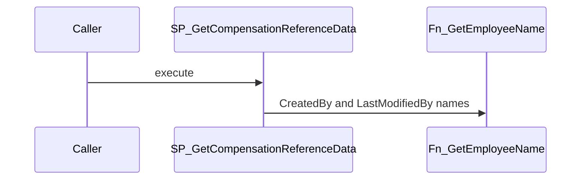
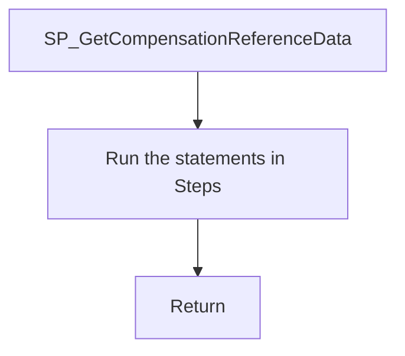

# SP_GetCompensationReferenceData

## What it does

Lists compensation reference data for an employer, with edit/delete flags based on use in TEmployeeSalaryStructure.

## Parameters

| Name | Direction | What it is for |
|---|---|---|
| `@EmployerId` | in | Employer scope |
| `@ReferenceId` | in | Optional single-row filter |

## Call sequence

## Callers

No other procedure or function calls this object.

## Nested

| Object | Kind | When | Page |
|---|---|---|---|
| `Fn_GetEmployeeName` | function | CreatedBy and LastModifiedBy names | [Fn_GetEmployeeName](/docs/database/hrms/Fn_GetEmployeeName) |

## Steps

1. Build #UsedCompensation from distinct CompensationTypeId in TEmployeeSalaryStructure.
2. Select reference rows with formatted names via fn_getEmployeeName and IsDeleteAllowed/IsEditAllowed from the used set.
3. Filter by employer and optional ReferenceId.
4. Order by ReferenceId.

## Tables

| Table | Read or write |
|---|---|
| `dbo.TCompensationReferenceData` | read |
| `dbo.TEmployeeSalaryStructure` | read |
| `dbo.TEmployee` | read |

## Flow

