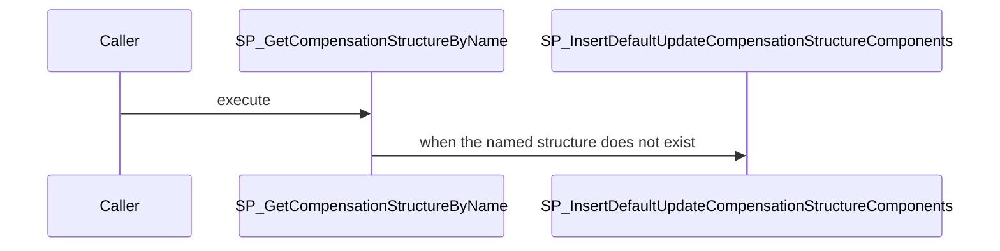
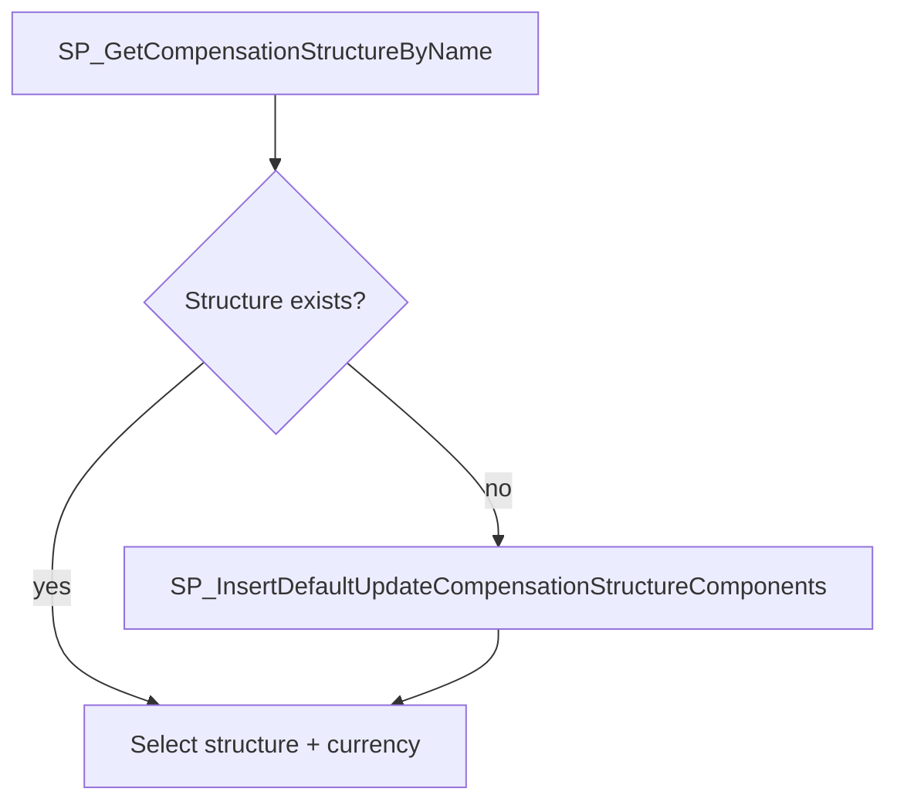

# SP_GetCompensationStructureByName

## What it does

Returns a named compensation structure for an employer. If missing, creates DefaultCompensationStructure via nested SP_InsertDefaultUpdateCompensationStructureComponents, then returns that structure.

## Parameters

| Name | Direction | What it is for |
|---|---|---|
| `@employerId` | in | Employer |
| `@CompensationStructureName` | in | Requested structure name |

## Call sequence

## Callers

No other procedure or function calls this object.

## Nested

| Object | Kind | When | Page |
|---|---|---|---|
| `SP_InsertDefaultUpdateCompensationStructureComponents` | procedure | when the named structure does not exist | [SP_InsertDefaultUpdateCompensationStructureComponents](/docs/database/hrms/SP_InsertDefaultUpdateCompensationStructureComponents) |

## Steps

1. If a matching structure exists, use that name.
2. Else EXEC SP_InsertDefaultUpdateCompensationStructureComponents with DefaultCompensationStructure and Currency 99, capturing the identity into a dummy table.
3. Select TOP 1 structure id, name, currency code, and currency id joined to TCOUNTRY.

## Tables

| Table | Read or write |
|---|---|
| `dbo.TCompensationStructure` | read/write via nested |
| `dbo.TCOUNTRY` | read |

## Flow

