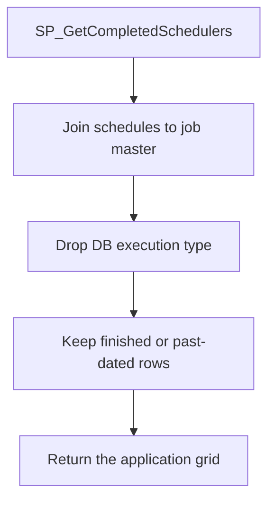

# SP_GetCompletedSchedulers

## What it does

Returns the Application Schedulers panel on the dashboard. It lists non-database runs that are finished, ended in error while still `EXECUTING`, or whose start and end dates are both before today. The result does not include `StartTimeCharValue` or `EndTimeCharValue`.

## Parameters

| Name | Direction | What it is for |
|---|---|---|
| `@EmployerId` | in | Organisation whose finished runs are listed |

## Call sequence

Calls no other procedures or functions.

## Callers

Procedures and functions that call this object.

No other procedure or function calls this object.

## Nested

Calls no other procedures or functions.

## Steps

1. In `HRMS-DATABASE/HRMS/STOREPROCEDURE/SP_GetCompletedSchedulers.sql`, set `@CURRENTDATE` to `GETDATE()`.

2. Select schedule columns, including `SchedulerStatus`, `UpdatedCount`, `Error`, `ExecutionType`, and `ExecutedBy`, from `TSchedulers` joined to `TJobSchedulerMaster`.

3. Keep rows for `@EmployerId` where `ExecutionType` is not `DB`, and either both start and end dates are before today, or `Status` is `COMPLETED` or `RUN_WITH_ERRORS`, or `SchedulerStatus` is `ERROR` while `Status` is `EXECUTING`.

4. Order by `CreateDate` descending.

## Tables

| Table | Read or write |
|---|---|
| `TSchedulers` | read |
| `TJobSchedulerMaster` | read |

## Flow

