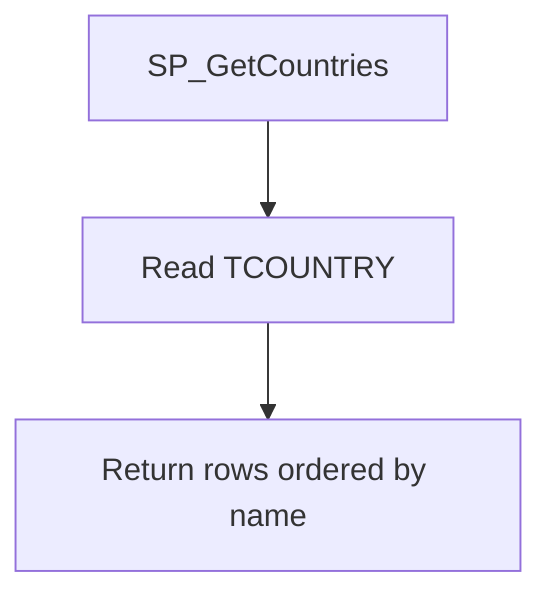

# SP_GetCountries

## What it does

Returns every country for the organisation country combo, ordered by NICENAME.

## Parameters

This procedure has no parameters.

## Call sequence

Calls no other procedures or functions.

## Callers

Procedures and functions that call this object.

No other procedure or function calls this object.

## Nested

Calls no other procedures or functions.

## Steps

1. Select ID, NICENAME, CountryCode, and ISO as ISOCountryCode from TCOUNTRY, ordered by NICENAME.

## Tables

| Table | Read or write |
|---|---|
| `TCOUNTRY` | read |

## Flow

