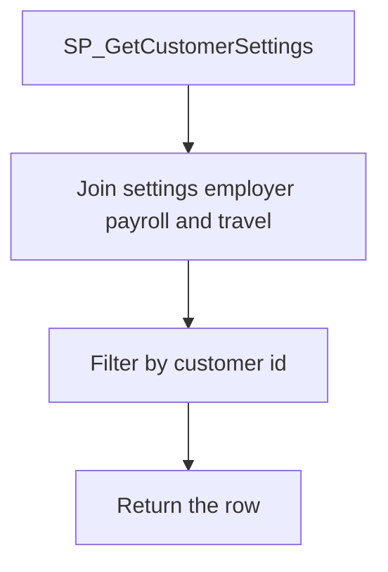

# SP_GetCustomerSettings

## What it does

Returns customer settings for one customer number, joined to the employer and to payroll and travel configuration. Add Organization reads IsPayrollCycleFrequencyEnabled and IsShowAttendanceMode from this row.

## Parameters

| Name | Direction | What it is for |
|---|---|---|
| `@CustomerId` | in | Customer number |

## Call sequence

Calls no other procedures or functions.

## Callers

Procedures and functions that call this object.

No other procedure or function calls this object.

## Nested

Calls no other procedures or functions.

## Steps

1. Select customer setting columns, employer performance flags, and parent-employer overrides for a few flags.

2. Join TCustomerSettings to TEmployerDetails on EmployerId, left join TExternal_Payroll_Configuration on CustomerId, left join TTNEEmployerConfiguration on EmployerId, and left join the parent employer's TCustomerSettings.

3. Filter where TCustomerSettings.CustomerId equals @CustomerId.

## Tables

| Table | Read or write |
|---|---|
| `TCustomerSettings` | read |
| `TEmployerDetails` | read |
| `TExternal_Payroll_Configuration` | read |
| `TTNEEmployerConfiguration` | read |

## Flow

