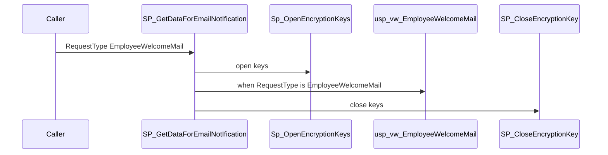
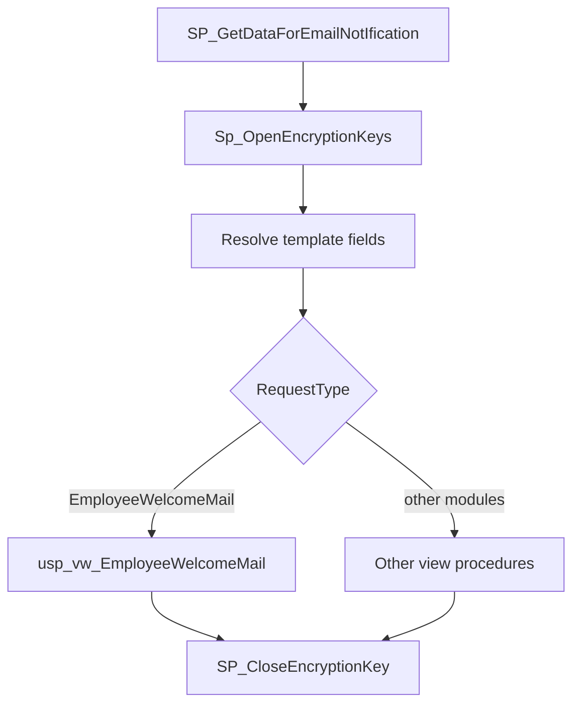

# SP_GetDataForEmailNotIfication

## What it does

Large email-placeholder dispatcher. It opens encryption keys, resolves template field lists for `@RequestType` / `@TemplateType` / `@Employerid`, then executes a request-type-specific view procedure to return placeholder values. Welcome-email preview calls it with `@RequestType` `EmployeeWelcomeMail`, which runs `usp_vw_EmployeeWelcomeMail`. Many other HRMS modules share the same procedure through other `@RequestType` branches.

## Parameters

| Name | Direction | What it is for |
|---|---|---|
| `@RequestType` | in | Template / form name that selects the data branch |
| `@TransId` | in | Transaction id passed to the nested view procedure (welcome-request id for this feature) |
| `@TemplateType` | in | Template type such as `N` |
| `@Employerid` | in | Employer context for template field resolution |
| `@ChildTransIDs` | in | Optional child transaction list for some modules |
| `@EmployeeId` | in | Optional employee override for some branches |

## Call sequence

## Callers

No other procedure or function calls this object. Application caller for this feature: `EmailHelper.GetEmailBodyFieldValues` (`sp_GetDataForEmailNotification` command name) from dashboard welcome-email preview.

## Nested

Nested objects on the welcome-email path only. The script also `EXEC`s many other module view procedures for different `@RequestType` values; those are out of scope for this page's one nested level for Removed Welcome Emails.

| Object | Kind | When | Page |
|---|---|---|---|
| `Sp_OpenEncryptionKeys` | procedure | start of body | [Sp_OpenEncryptionKeys](/docs/database/hrms/Sp_OpenEncryptionKeys) |
| `usp_vw_EmployeeWelcomeMail` | procedure | `@RequestType = 'EmployeeWelcomeMail'` | [usp_vw_EmployeeWelcomeMail](/docs/database/hrms/usp_vw_EmployeeWelcomeMail) |
| `SP_CloseEncryptionKey` | procedure | end of body | [SP_CloseEncryptionKey](/docs/database/hrms/SP_CloseEncryptionKey) |

## Steps

1. Execute `Sp_OpenEncryptionKeys`.
2. Normalize selected request-type aliases and template-type defaults.
3. Resolve template field / column lists for the employer and request type.
4. When `@RequestType = 'EmployeeWelcomeMail'`, execute `usp_vw_EmployeeWelcomeMail` with `@TransId` and the column list.
5. Other `@RequestType` values follow parallel branches into module-specific view procedures.
6. Execute `SP_CloseEncryptionKey`.

## Tables

| Table | Read or write |
|---|---|
| `dbo.TEmailTemplates` and related template-field sources | read (field resolution) |
| Module tables via nested view procedures | read |

Exact table set depends on `@RequestType`. For welcome mail, see [usp_vw_EmployeeWelcomeMail](/docs/database/hrms/usp_vw_EmployeeWelcomeMail).

## Unresolved calls

Dynamic SQL and many non-welcome `@RequestType` `EXEC` targets are present in the script. They are not expanded here beyond the welcome-email branch used by Removed Welcome Emails preview.

## Flow

