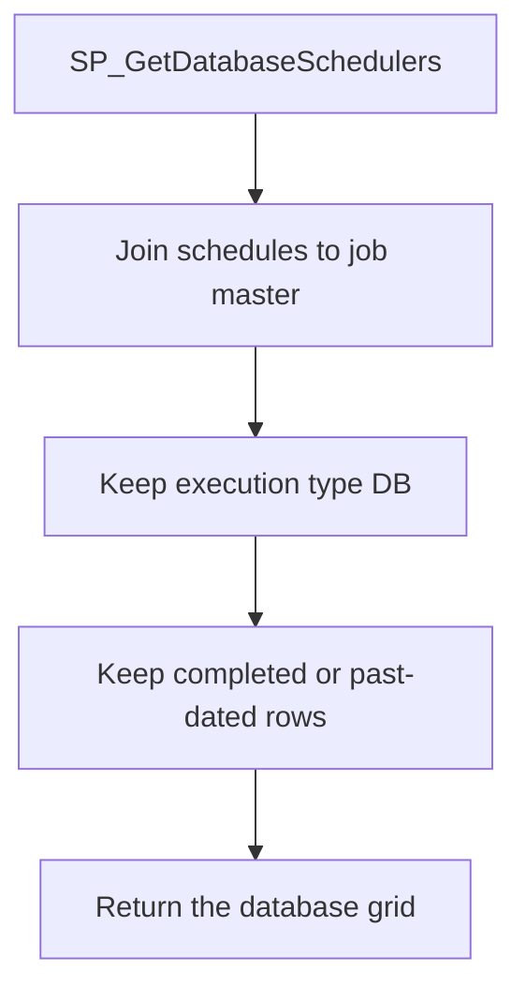

# SP_GetDatabaseSchedulers

## What it does

Returns the Database Schedulers panel. It lists rows whose `ExecutionType` is `DB` and that are either `COMPLETED` or have both start and end dates before today. It does not take an employer id. It does return `StartTimeCharValue` and `EndTimeCharValue`.

## Parameters

This procedure declares no parameters.

## Call sequence

Calls no other procedures or functions.

## Callers

Procedures and functions that call this object.

No other procedure or function calls this object.

## Nested

Calls no other procedures or functions.

## Steps

1. In `HRMS-DATABASE/HRMS/STOREPROCEDURE/SP_GetDatabaseSchedulers.sql`, set `@CURRENTDATE` to `GETDATE()`.

2. Select id, job name, start and end dates, start and end times and their `varchar(5)` forms, create date, scheduler status, error, and execution type from `TSchedulers` joined to `TJobSchedulerMaster`.

3. Keep rows where `ExecutionType` is `DB` and either both dates are before today or `Status` is `COMPLETED`. Order by `CreateDate` descending.

## Tables

| Table | Read or write |
|---|---|
| `TSchedulers` | read |
| `TJobSchedulerMaster` | read |

## Flow

