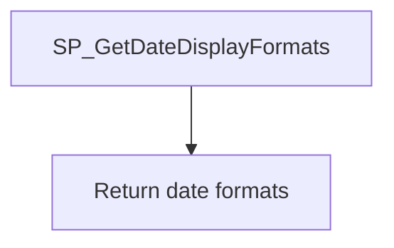

# SP_GetDateDisplayFormats

## What it does

Returns every row from `TDateFormatMaster` with `DateFormatId`, `DisplayName`, `IsDefault`, and an `IsSelected` flag that mirrors the default. Used by Doc Builder for the template date-display dropdown. Takes no parameters (the Node route still posts `employerId`).

## Parameters

None.

## Call sequence

Calls no other procedures or functions.

## Callers

No other procedure or function calls this object. `DocBuilderDAL.GetDateDisplay` executes it from Doc Builder.

## Nested

Calls no other procedures or functions.

## Steps

1. Select from `TDateFormatMaster` ordered by default first, then `DateFormatId`.

## Tables

| Table | Read or write |
|---|---|
| `dbo.TDateFormatMaster` | read |

## Unresolved calls

None.

## Flow

