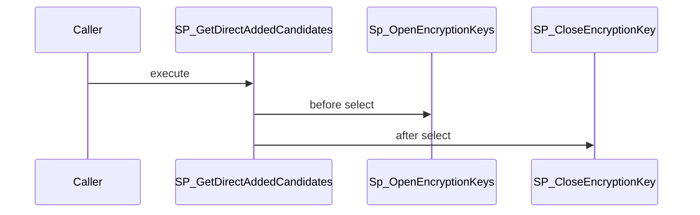
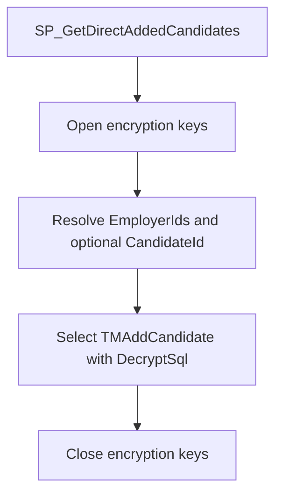

# SP_GetDirectAddedCandidates

## What it does

Returns direct-added Offer Rolled Out candidates from `TMAddCandidate`, with designation and office location titles and decrypted CTC columns. Optional filters narrow by employer list, creator employee, and candidate id.

## Parameters

| Name | Direction | What it is for |
|---|---|---|
| `@EmployerId` | in | Default employer when `@EmployerIds` is null |
| `@EmployeeId` | in | Optional creator filter (`CreatedBy`) |
| `@CandidateId` | in | Optional single candidate; also resets `@EmployerId` from that row |
| `@EmployerIds` | in | Comma-separated employer ids; defaults to `@EmployerId` |

## Call sequence

## Callers

No other procedure or function calls this object.

## Nested

| Object | Kind | When | Page |
|---|---|---|---|
| `Sp_OpenEncryptionKeys` | procedure | before the select | [Sp_OpenEncryptionKeys](/docs/database/hrms/Sp_OpenEncryptionKeys) |
| `SP_CloseEncryptionKey` | procedure | after the select | [SP_CloseEncryptionKey](/docs/database/hrms/SP_CloseEncryptionKey) |
| `DecryptSql` | function | AnnualCTC / MonthlyCTC / MonthlyInHandCTC columns | [DecryptSql](/docs/database/hrms/DecryptSql) |

## Steps

1. Open encryption keys (`Sp_OpenEncryptionKeys`).
2. If `@EmployerIds` is null, set it to `@EmployerId`.
3. If `@CandidateId` is not null, set `@EmployerId` from `TMAddCandidate` for that candidate.
4. Select from `TMAddCandidate` where employer is in the split `@EmployerIds` list, status is not `Deleted`, and optional creator/candidate filters match. Decrypt CTC columns; resolve designation and location names from `TTitle` / `TLocation`.
5. Close encryption keys (`SP_CloseEncryptionKey`).

## Tables

| Table | Read or write |
|---|---|
| `TMAddCandidate` | read |
| `TTitle` | read |
| `TLocation` | read |

## Flow

