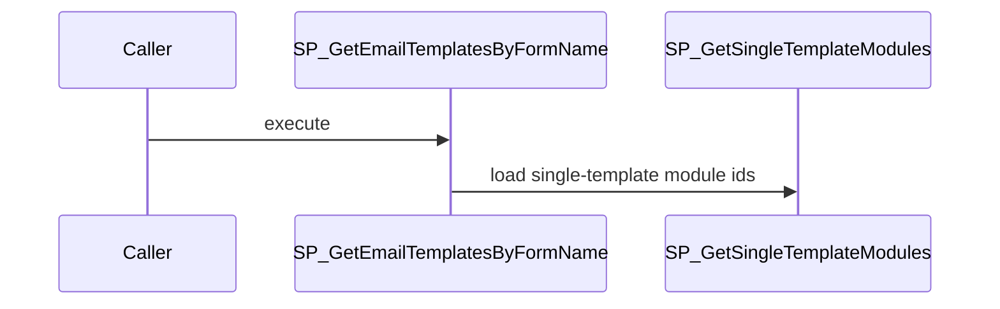
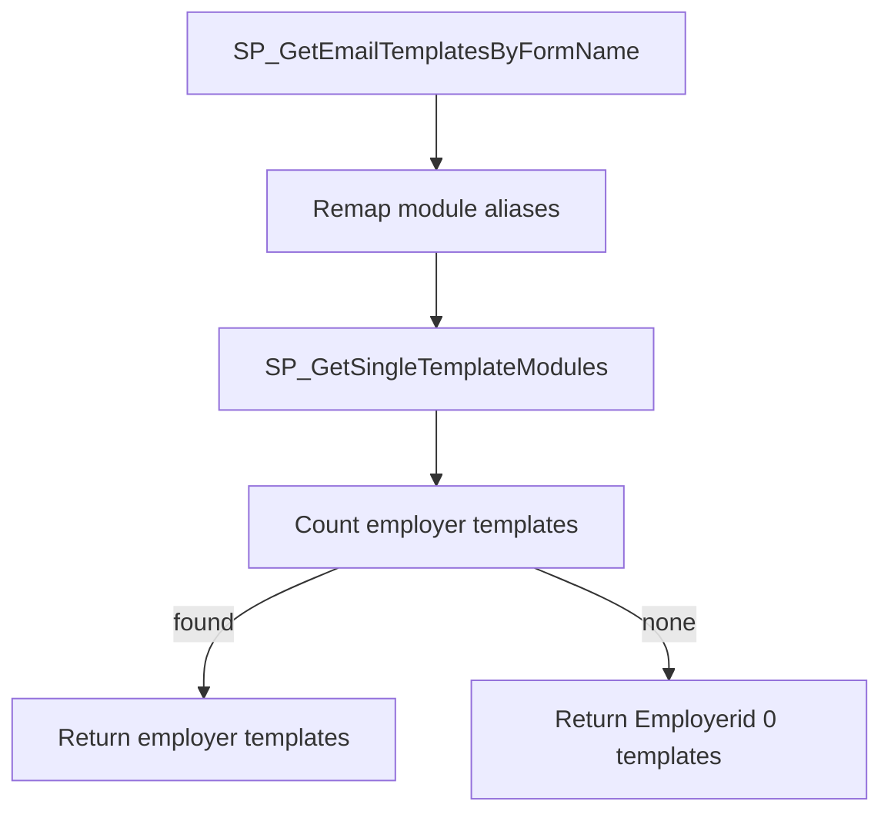

# SP_GetEmailTemplatesByFormName

## What it does

Returns email template metadata for a module page name and template type. It remaps a few legacy module aliases, loads the single-template module-page id list, counts employer-specific templates, and returns either those rows or the `Employerid = 0` default templates when none exist for the employer. Welcome-email preview calls it with `@Templatemodule` `EmployeeWelcomeMail` and `@TemplateType` `N`.

## Parameters

| Name | Direction | What it is for |
|---|---|---|
| `@Templatemodule` | in | Module page name (for example `EmployeeWelcomeMail`) |
| `@TemplateType` | in | Template type (`N` / `NA` treated together, or a specific type) |
| `@Employerid` | in | Employer whose templates are preferred |
| `@WorkflowId` | in | Optional workflow id; `0` is treated as null |

## Call sequence

## Callers

No other procedure or function calls this object. Application callers include `DBHelper.GetHtmlTemplateByPage` used by dashboard welcome-email preview.

## Nested

| Object | Kind | When | Page |
|---|---|---|---|
| `SP_GetSingleTemplateModules` | procedure | before counting or selecting templates | [SP_GetSingleTemplateModules](/docs/database/hrms/SP_GetSingleTemplateModules) |

## Steps

1. Normalize `@WorkflowId` when it is `0`.
2. Remap selected `@Templatemodule` aliases (`EmployeeGoalSetting`, `CandidateScheduleInterview`, `WorkFromHome`).
3. Insert results of `SP_GetSingleTemplateModules` into a table variable.
4. Count matching non-deleted `TEmailTemplates` for the employer and module page.
5. If count is greater than zero, return those employer templates (with `N`/`NA` handling when requested).
6. Otherwise return default templates where `Employerid = 0` for the same module and type.

## Tables

| Table | Read or write |
|---|---|
| `dbo.TEmailTemplates` | read |
| `dbo.TModulePages` | read |

## Flow

