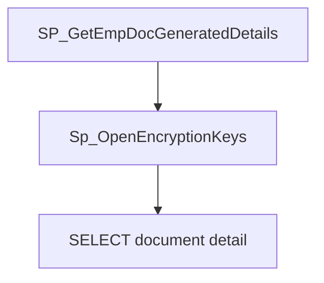

# SP_GetEmpDocGeneratedDetails

## What it does

Loads one generated ESS document metadata including path and acceptance flags for the accept or decline modal.

## Parameters

| Name | Direction | What it is for |
|---|---|---|
| `@EmployerID` | in | Employer |
| `@DocumentGenerationID` | in | DocumentGenerateID |

## Call sequence

Calls nested procedures listed under Nested when present; otherwise runs inline SQL only.

## Callers

| Object | Kind |
|---|---|
| `EmployeeDal.GetDocumentDetailsByID` | procedure |
| `EmployeeSelfService.aspx.cs` | application |

## Nested

- [`Sp_OpenEncryptionKeys`](/docs/database/hrms/Sp_OpenEncryptionKeys)

## Steps

1. Open encryption keys and SELECT document plus template acceptance flags for the id.

## Tables

| Table | Read or write |
|---|---|
| `TEmployeeDocumentGeneratedDetails` | read |
| `TDocumentTemplates` | read |
| `TEmployee` | read |

## Unresolved calls

None noted for this feature pass.

## Flow

