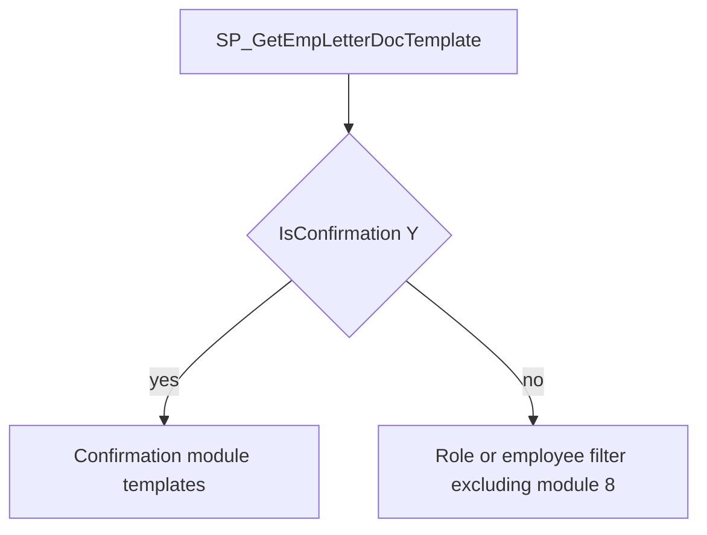

# SP_GetEmpLetterDocTemplate

## What it does

Lists letter templates for an employer from TDocumentTemplates. Confirmation mode keeps modules whose name starts with Confirmation. Otherwise it keeps templates the employee or the employee's role may see, and it drops module 8.

## Parameters

| Name | Direction | What it is for |
|---|---|---|
| `@Employerid` | in | Employer |
| `@Isactive` | in | Active flag. Null returns both |
| `@IsConfirmation` | in | Y limits the list to confirmation modules |
| `@EmployeeId` | in | Employee used for the role and employee filter |

## Call sequence

Calls no other procedures or functions.

## Callers

No other procedure or function calls this object.

## Nested

Calls no other procedures or functions.

## Steps

1. When `@IsConfirmation` is Y, select non-deleted templates whose module name starts with Confirmation (`SP_GetEmpLetterDocTemplate.sql`).
2. Otherwise read the employee's role from `tUsers` and `tUserEmployee`.
3. Return non-deleted templates for the employer where role and employee lists are empty, or the role or employee is in those lists, and `ModuleId` is not 8.

## Tables

| Table | Read or write |
|---|---|
| `dbo.TDocumentTemplates` | read |
| `dbo.THrmsModules` | read |
| `dbo.tUsers` | read |
| `dbo.tUserEmployee` | read |

## Flow

