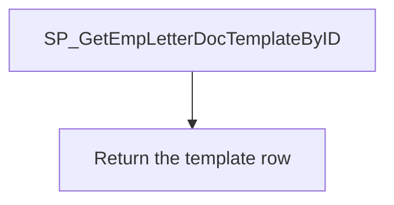

# SP_GetEmpLetterDocTemplateByID

## What it does

Returns one template row from TDocumentTemplates, including acceptance, acknowledgement, timeline, category, and whether the ESS header and footer default is used.

## Parameters

| Name | Direction | What it is for |
|---|---|---|
| `@DocumentId` | in | Template id |

## Call sequence

Calls no other procedures or functions.

## Callers

No other procedure or function calls this object.

## Nested

Calls no other procedures or functions.

## Steps

1. Select the template columns from `TDocumentTemplates` where `Documentid` equals `@DocumentId` (`SP_GetEmpLetterDocTemplateByID.sql`).

## Tables

| Table | Read or write |
|---|---|
| `dbo.TDocumentTemplates` | read |

## Flow

