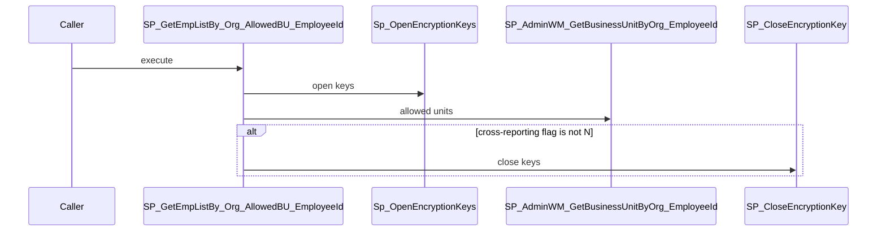
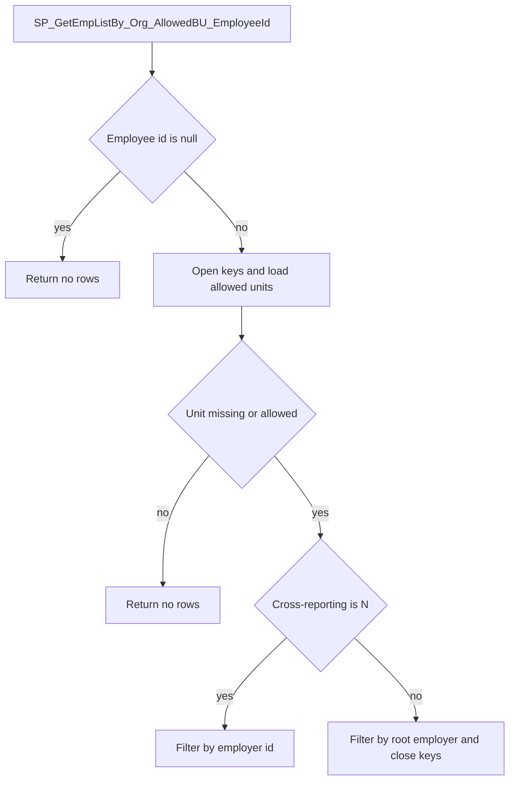

# SP_GetEmpListBy_Org_AllowedBU_EmployeeId

## What it does

Returns `EmployeeID` and `Name` for active employees in one organization. When no business unit is passed, the list is limited to units the employee is allowed to see. When a business unit is passed, it must be in that allowed set or the procedure returns no rows.

The script header says this matches `USP_GetEmpListByOrgBU` with that extra allowed-unit filter. The inventory file begins with `USE [HRM-CL-Prod]`.

## Parameters

| Name | Direction | What it is for |
|---|---|---|
| `@BusinessUnitId` | in | Unit to list. Null lists every allowed unit. The chart DAL sends null when the query value is missing or 0 |
| `@OrganizationId` | in | Employer, or the root-employer scope when cross-reporting applies |
| `@EmployeeId` | in | Employee whose allowed units are loaded. Null returns an empty shape and stops |
| `@Active` | in | `TEmployee.IsActive` filter. Default `Y`. The chart DAL does not pass it |

## Call sequence

## Callers

| Object | Kind | Page |
|---|---|---|
| `dashBoardDAL.GetEmployeeListByOrgBuEmployeeId` | app | [View Organization Chart](/docs/guides/admin-configuration/view-organization-chart) |

No other procedure in `STOREPROCEDURE/` executes it.

## Nested

| Object | Kind | When | Page |
|---|---|---|---|
| `Sp_OpenEncryptionKeys` | procedure | After the null-employee exit | [Sp_OpenEncryptionKeys](/docs/database/hrms/Sp_OpenEncryptionKeys) |
| `SP_AdminWM_GetBusinessUnitByOrg_EmployeeId` | procedure | To fill `#AllowedBU` | [SP_AdminWM_GetBusinessUnitByOrg_EmployeeId](/docs/database/hrms/SP_AdminWM_GetBusinessUnitByOrg_EmployeeId) |
| `Fn_GetEmployeeName` | function | Every returned name | [Fn_GetEmployeeName](/docs/database/hrms/Fn_GetEmployeeName) |
| `SP_CloseEncryptionKey` | procedure | Only in the branch where cross-reporting is not `N` | [SP_CloseEncryptionKey](/docs/database/hrms/SP_CloseEncryptionKey) |

## Steps

In `HRMS-DATABASE/HRMS/STOREPROCEDURE/SP_GetEmpListBy_Org_AllowedBU_EmployeeId.sql`:

1. When `@EmployeeId` is null, return an empty `EmployeeID` / `Name` result and stop. Keys are not opened.
2. Execute `Sp_OpenEncryptionKeys`.
3. Read `IsCrossReportingApplicable` from `TemployerDetails` for `@OrganizationId`.
4. Insert `#AllowedBU` by executing `SP_AdminWM_GetBusinessUnitByOrg_EmployeeId` with `@EmployeeId` and `@OrganizationId`.
5. When `@BusinessUnitId` is not null and is not in `#AllowedBU`, return an empty result and stop. Keys stay open on this path.
6. When the flag is `N` and `@BusinessUnitId` is null, list active employees in `#AllowedBU` whose `TEmployeeInfo.EmployerID` is `@OrganizationId`.
7. When the flag is `N` and a unit was passed, list active employees in that unit and employer. `FName = 'Root'` is excluded in both `N` selects.
8. Otherwise read `RootEmployerId` from `Temployeeinfo` for `@OrganizationId`.
9. With a null unit, list active employees in `#AllowedBU` whose info `RootEmployerId` matches. With a unit, list that unit under the same root employer.
10. Names are `Fn_GetEmployeeName` plus `Employmentnumber`. Order by name.
11. `SP_CloseEncryptionKey` runs only at the end of step 8's branch.

## Tables

| Table | Read or write |
|---|---|
| `dbo.TemployerDetails` | read |
| `dbo.Temployeeinfo` / `dbo.TEmployeeInfo` | read |
| `dbo.TEmployee` | read |
| `#AllowedBU` | write |

## Unresolved calls

`USP_GetEmpListByOrgBU` is named in a comment and is not executed.

## Flow

