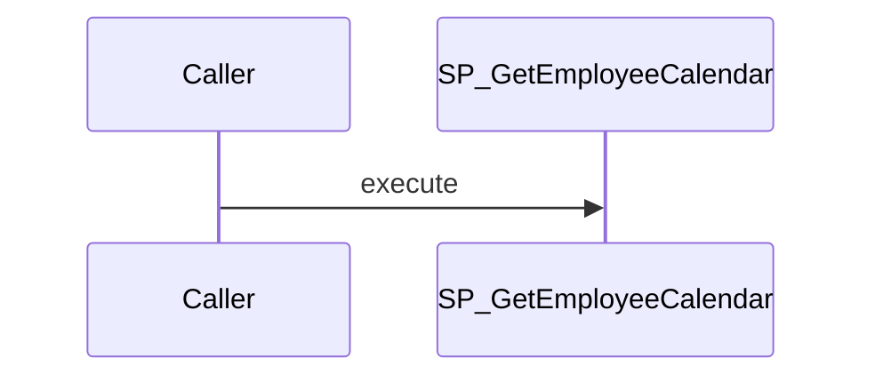
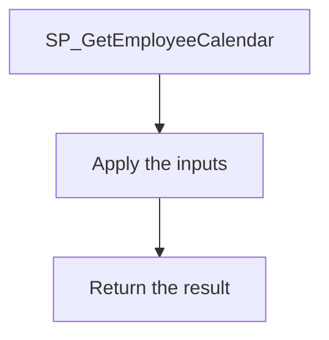

# SP_GetEmployeeCalendar

## What it does

Returns the calendar id and calendar name stored on the employee. The Holidays card selects that calendar by default.

## Parameters

| Name | Direction | What it is for |
|---|---|---|
| `@EmployeeId` | in | Employee the Home screen is loading or acting for (`int`) |

## Call sequence

## Callers

No other procedure or function under STOREPROCEDURE or FUNCTIONS executes this object.

## Nested

This object does not execute another procedure or user-defined function.

## Steps

In `HRMS-DATABASE/HRMS/STOREPROCEDURE/SP_GetEmployeeCalendar.sql`:

1. Returns the calendar id and calendar name stored on the employee.
2. The Holidays card selects that calendar by default.

## Tables

| Table | Read or write |
|---|---|
| `temployeeinfo` | read |
| `TCalendarMaster` | read |

## Flow

