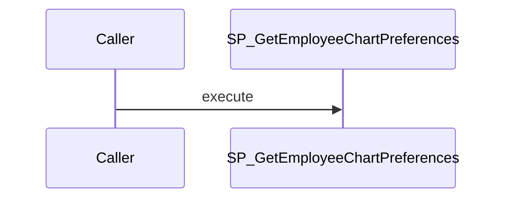
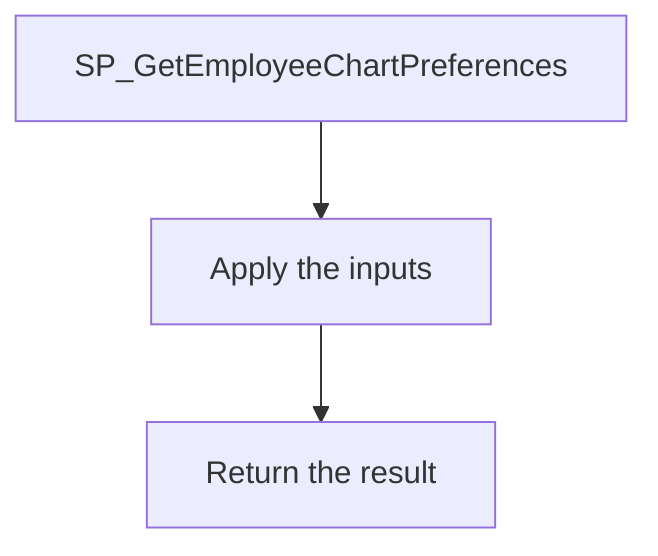

# SP_GetEmployeeChartPreferences

## What it does

Loads the classic management-dashboard chart list and which of those charts the employee has selected, in employer sequence.

## Parameters

| Name | Direction | What it is for |
|---|---|---|
| `@EmployeeId` | in | Employee the Home screen is loading or acting for (`int null`) |
| `@EmployerId` | in | Employer that owns the data (`int null`) |

## Call sequence

## Callers

No other procedure or function under STOREPROCEDURE or FUNCTIONS executes this object.

## Nested

This object does not execute another procedure or user-defined function.

## Steps

In `HRMS-DATABASE/HRMS/STOREPROCEDURE/SP_GetEmployeeChartPreferences.sql`:

1. Loads the classic management-dashboard chart list and which of those charts the employee has selected, in employer sequence.

## Tables

| Table | Read or write |
|---|---|
| `TEmployeeChartPreferences` | read |
| `TChartPreferences` | read |

## Flow

