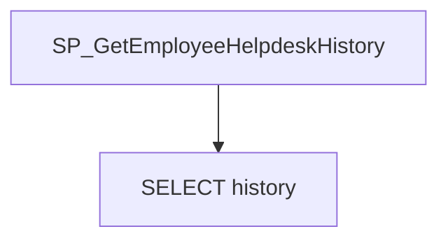

# SP_GetEmployeeHelpdeskHistory

## What it does

Returns history rows for a help-desk request shown in the history popup.

## Parameters

| Name | Direction | What it is for |
|---|---|---|
| `@HelpdeskRequestId` | in | Request id |
| `@EmployeeId` | in | Context employee |
| `@EmployerId` | in | Employer |

## Call sequence

Calls nested procedures listed under Nested when present; otherwise runs inline SQL only.

## Callers

| Object | Kind |
|---|---|
| `HelpDeskDAL.GetHelpdeskHistory` | procedure |

## Nested

Calls no other procedures or functions.

## Steps

1. SELECT THelpDeskHistory for the request.

## Tables

| Table | Read or write |
|---|---|
| `THelpDeskHistory` | read |

## Unresolved calls

None noted for this feature pass.

## Flow

