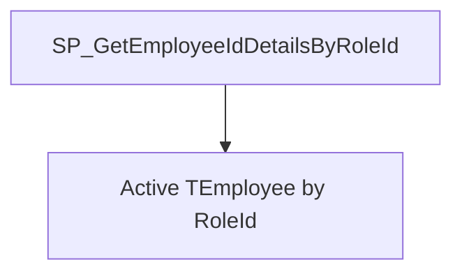

# SP_GetEmployeeIdDetailsByRoleId

## What it does

Returns active employees whose `TEmployee.RoleId` equals `@RoleId`. Workflow Group Setup calls this before soft-delete as a membership guard, but `TEmployee.RoleId` is the access-right role, not `tRoleEmployeeMapping.Roleid`, so the result does not measure workflow-group members.

## Parameters

| Name | Direction | What it is for |
|---|---|---|
| `@RoleId` | in | Compared to `TEmployee.RoleId` |

## Call sequence

Calls no other procedures or functions.

## Callers

| Object | Kind | Page |
|---|---|---|
| Application only | WebForms DAL | Workflow Group Setup delete guard |

`WorkflowManagementDAL.GetEmployeeIdsByRoleId` executes this procedure.

## Nested

Calls no other procedures or functions.

## Steps

1. Select `RoleId` and `EmployeeId` from `TEmployee` where `RoleId = @RoleId` and `IsActive = 'Y'`.

## Tables

| Table | Read or write |
|---|---|
| `TEmployee` | read |

## Unresolved calls

None.

## Flow

