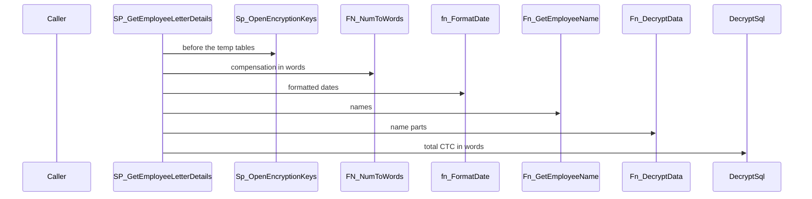
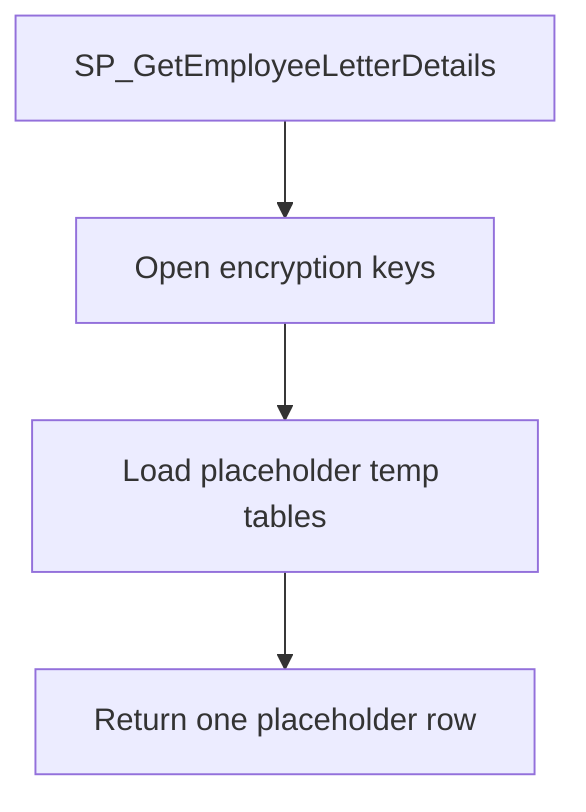

# SP_GetEmployeeLetterDetails

## What it does

Returns one wide result set of letter placeholders for an employee. It opens encryption keys, loads notice period, designation, education, compensation, bank, resignation, and termination into temp tables, then selects formatted dates, decrypted names, and compensation words. The script does not call SP_CloseEncryptionKey.

## Parameters

| Name | Direction | What it is for |
|---|---|---|
| `@EmployeeId` | in | Employee |
| `@DocumentId` | in | Optional. Null returns the employee row without a document-id filter on the final select |

## Call sequence

## Callers

No other procedure or function calls this object.

## Nested

| Object | Kind | When | Page |
|---|---|---|---|
| `Sp_OpenEncryptionKeys` | procedure | before the temp tables | [Sp_OpenEncryptionKeys](/docs/database/hrms/Sp_OpenEncryptionKeys) |
| `FN_NumToWords` | function | compensation in words | [FN_NumToWords](/docs/database/hrms/FN_NumToWords) |
| `fn_FormatDate` | function | formatted dates | [fn_FormatDate](/docs/database/hrms/fn_FormatDate) |
| `Fn_GetEmployeeName` | function | names | [Fn_GetEmployeeName](/docs/database/hrms/Fn_GetEmployeeName) |
| `Fn_DecryptData` | function | name parts | [Fn_DecryptData](/docs/database/hrms/Fn_DecryptData) |
| `DecryptSql` | function | total CTC in words | [DecryptSql](/docs/database/hrms/DecryptSql) |

## Steps

1. Open encryption keys (`SP_GetEmployeeLetterDetails.sql`).
2. Build temp tables for notice period, designation, education, monthly and yearly compensation, bank, resignation, and termination.
3. Select placeholder columns for the employee, formatting dates with `fn_FormatDate` and names with `Fn_GetEmployeeName` and `Fn_DecryptData`.
4. The script ends after the select and does not close the encryption key.

## Tables

| Table | Read or write |
|---|---|
| `dbo.TEmployee` | read |
| `dbo.TEmployeeInfo` | read |
| `dbo.TEmployerDetails` | read |
| `dbo.TDocumentTemplates` | read |
| `dbo.TEmployeeDocumentGeneratedDetails` | read |
| `dbo.TPersonalTitle` | read |
| `dbo.TCountryStates` | read |
| `dbo.TResignationDetails` | read |

## Flow

