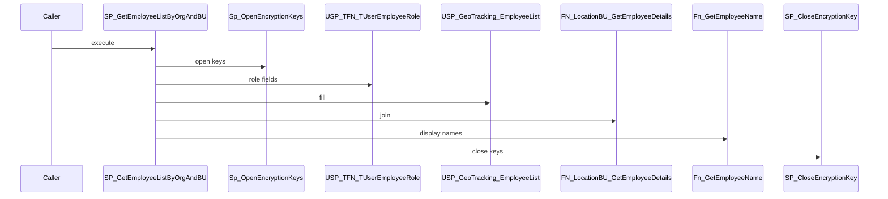
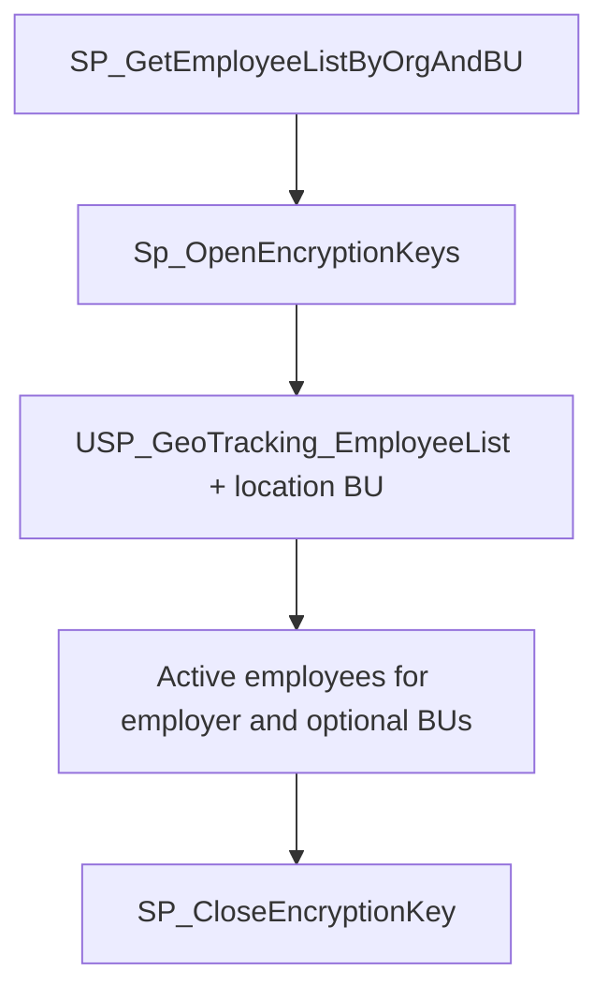

# SP_GetEmployeeListByOrgAndBU

## What it does

Returns active employees for an employer, optionally filtered by a comma-separated business-unit list, further limited to employees the login user may see. Opens encryption keys, loads role scope via `USP_GeoTracking_EmployeeList`, applies `FN_LocationBU_GetEmployeeDetails`, and returns display names that include employment number and employer name.

## Parameters

| Name | Direction | What it is for |
|---|---|---|
| `@EmployerID` | in | Employer of `TEmployeeInfo` |
| `@BusinessUnitIds` | in | Optional comma-separated unit ids |
| `@LoggedinUserId` | in | Login employee for role and location-BU scope |

## Call sequence

## Callers

No other procedure or function calls this object. `GeoTrackingDAL.GetEmployeeListByOrgAndBU` executes it.

## Nested

| Object | Kind | When | Page |
|---|---|---|---|
| `Sp_OpenEncryptionKeys` | procedure | start | [Sp_OpenEncryptionKeys](/docs/database/hrms/Sp_OpenEncryptionKeys) |
| `USP_TFN_TUserEmployeeRole` | function | read role fields | [USP_TFN_TUserEmployeeRole](/docs/database/hrms/USP_TFN_TUserEmployeeRole) |
| `USP_GeoTracking_EmployeeList` | procedure | fill `#Employees` | [USP_GeoTracking_EmployeeList](/docs/database/hrms/USP_GeoTracking_EmployeeList) |
| `FN_LocationBU_GetEmployeeDetails` | function | join | [FN_LocationBU_GetEmployeeDetails](/docs/database/hrms/FN_LocationBU_GetEmployeeDetails) |
| `Fn_GetEmployeeName` | function | select list | [Fn_GetEmployeeName](/docs/database/hrms/Fn_GetEmployeeName) |
| `SP_CloseEncryptionKey` | procedure | end | [SP_CloseEncryptionKey](/docs/database/hrms/SP_CloseEncryptionKey) |

## Steps

1. In `HRMS-DATABASE/HRMS/STOREPROCEDURE/SP_GetEmployeeListByOrgAndBU.sql`, `EXEC Sp_OpenEncryptionKeys`.
2. Read role fields from `USP_TFN_TUserEmployeeRole`. If `@LoggedinUserId` is null, pick a RoleID=1 user for the employer (legacy fallback).
3. Fill `#Employees` from `USP_GeoTracking_EmployeeList`.
4. Select active employees for `@EmployerID` joined to `#Employees`, location-BU scope, `TEmployeeInfo`, and `TEmployerDetails`. Optional `STRING_SPLIT` on `@BusinessUnitIds`.
5. `EXEC SP_CloseEncryptionKey`.

## Tables

| Table | Read or write |
|---|---|
| `dbo.TEmployee` | read |
| `dbo.TEmployeeInfo` | read |
| `dbo.TEmployerDetails` | read |
| `dbo.TUserEmployee` | read (null-login fallback) |
| `dbo.TUsers` | read (null-login fallback) |

## Flow

