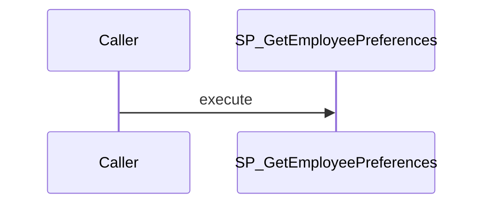
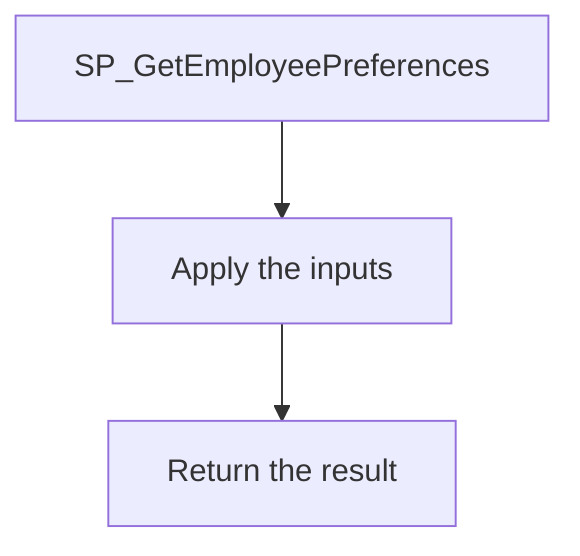

# SP_GetEmployeePreferences

## What it does

Loads the Home preference cards for one employee. It reads the saved id list, keeps only preferences whose module is enabled for the root employer, and marks each card selected or not, in the employee's sequence.

## Parameters

| Name | Direction | What it is for |
|---|---|---|
| `@EmployeeId` | in | Employee the Home screen is loading or acting for (`INT NULL`) |
| `@EmployerId` | in | Employer that owns the data (`INT NULL`) |

## Call sequence

## Callers

No other procedure or function under STOREPROCEDURE or FUNCTIONS executes this object.

## Nested

This object does not execute another procedure or user-defined function.

## Steps

In `HRMS-DATABASE/HRMS/STOREPROCEDURE/SP_GetEmployeePreferences.sql`:

1. Loads the Home preference cards for one employee.
2. It reads the saved id list, keeps only preferences whose module is enabled for the root employer, and marks each card selected or not, in the employee's sequence.

## Tables

| Table | Read or write |
|---|---|
| `TEmployeeHomePagePreferences` | read |
| `TEmployerDetails` | read |
| `TEmployerModule` | read |
| `THomePagePreferences` | read |

## Flow

