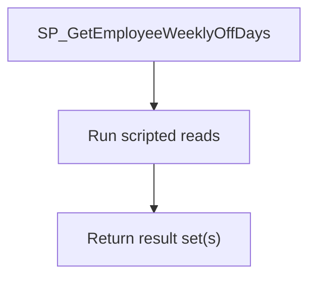

# SP_GetEmployeeWeeklyOffDays

## What it does

Nested weekly-off helper used by live attendance drilldown.

## Parameters

| Name | Direction | What it is for |
|---|---|---|
| — | — | No parameters declared |

## Call sequence

Calls no other procedures or functions.

## Callers

| Object | Kind | Page |
|---|---|---|
| `SP_LeaveAttendanceGetLiveAttendanceSummaryChart_DrillDown_Compact` | procedure | [SP_LeaveAttendanceGetLiveAttendanceSummaryChart_DrillDown_Compact](/docs/database/hrms/SP_LeaveAttendanceGetLiveAttendanceSummaryChart_DrillDown_Compact) |

Also invoked via `SP_LeaveAttendanceGetLiveAttendanceSummaryChart_DrillDown_Compact`.

## Nested

Calls no other procedures or functions.

## Steps

1. In `HRMS-DATABASE/HRMS/STOREPROCEDURE/SP_GetEmployeeWeeklyOffDays.sql`, accept the declared parameters and set `NOCOUNT` / read-uncommitted as scripted.
2. Run the SELECT branches shown in the script and return the result set(s).

## Tables

| Table | Read or write |
|---|---|
| — | No persistent tables detected in static parse |

## Flow

