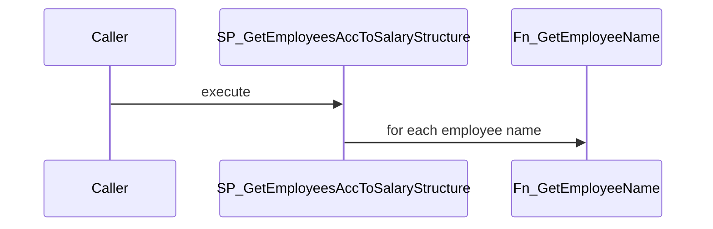
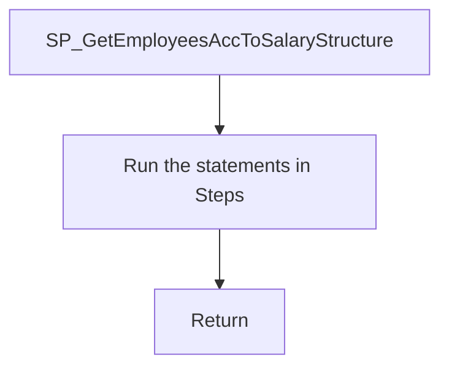

# SP_GetEmployeesAccToSalaryStructure

## What it does

Intended to list employees on a salary annexure. The filter compares EmployeeId to @Employerid, so behaviour does not match the parameter names.

## Parameters

| Name | Direction | What it is for |
|---|---|---|
| `@Employerid` | in | Passed as employer id from API but compared to EmployeeId |
| `@AnnexureId` | in | Annexure id |

## Call sequence

## Callers

No other procedure or function calls this object.

## Nested

| Object | Kind | When | Page |
|---|---|---|---|
| `Fn_GetEmployeeName` | function | for each employee name | [Fn_GetEmployeeName](/docs/database/hrms/Fn_GetEmployeeName) |

## Steps

1. Select distinct annexureid, EmployeeId, and Fn_GetEmployeeName from TEmployeeSalaryStructure.
2. Filter AnnexureId and EmployeeId = @Employerid.

## Tables

| Table | Read or write |
|---|---|
| `dbo.TEmployeeSalaryStructure` | read |

## Flow

