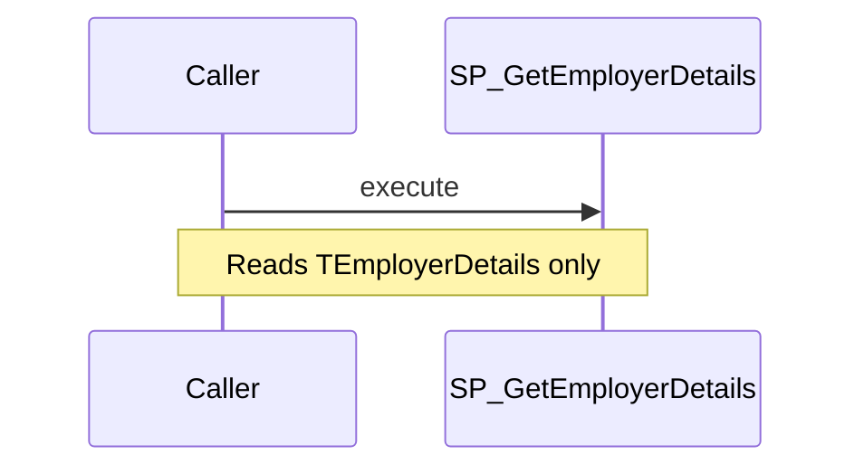
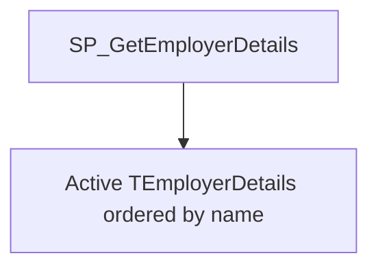

# SP_GetEmployerDetails

## What it does

Returns every active employer row from `TEmployerDetails`, ordered by name. Menu Manager uses the result for the organisation dual-list when applying a menu tree or granting tab access.

## Parameters

None.

## Call sequence

## Callers

No other procedure or function calls this object. `MenuManagerDAL.getAllOrganizations` executes it for Menu Manager (`GET /api/menuManagement/organizations`).

## Nested

Calls no other procedures or functions.

## Steps

1. In `HRMS-DATABASE/HRMS/STOREPROCEDURE/SP_GetEmployerDetails.sql`, select employer identity, addresses, contact, bank, logo, attendance capture type, parent employer, customer id, personal-data deletion flags, employment-number formatting flags, and cross-reporting flag from `TEmployerDetails`.
2. Restrict to `IsActive = 1`.
3. Order by `EmployerName`.

## Tables

| Table | Read or write |
|---|---|
| `dbo.TEmployerDetails` | read |

## Unresolved calls

None.

## Flow

