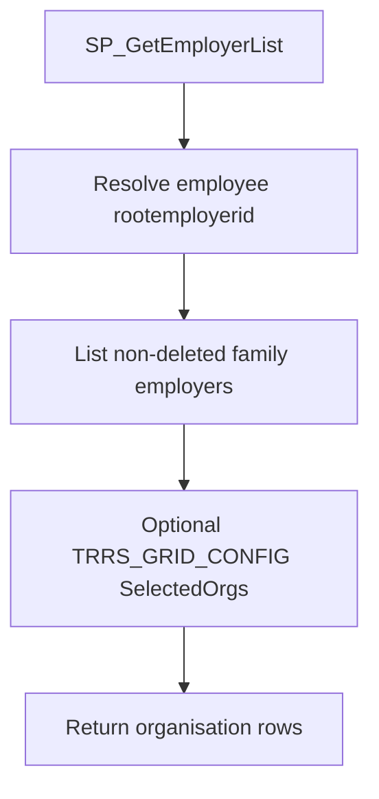

# SP_GetEmployerList

## What it does

Returns non-deleted organisations that share the same `rootemployerid` as the given employee’s employer. Each row includes employer name/id, `ParentEmployerid`, customer id, a derived `IsParentOrg` flag, and an optional selected-orgs config string from `TRRS_GRID_CONFIG` when `@GridId` is supplied for the employer-dropdown config type.

## Parameters

| Name | Direction | What it is for |
|---|---|---|
| `@EmployeeId` | in | Employee used to resolve the root employer family |
| `@GridId` | in | Optional grid id for `TRRS_GRID_CONFIG` selected-orgs lookup |

## Call sequence

Calls no other procedures or functions.

## Callers

No other procedure or function calls this object in the HRMS procedure/function trees searched for live `EXEC`/`dbo.` invocations. Application callers include Core API `preOnBoardingDAL.GetEmployerList` (My Details Field Config and other Pre-Onboarding screens). `SP_GetEmployerListGlobalAccess` is a separate sibling procedure with a similar shape, not a caller of this object.

## Nested

Calls no other procedures or functions.

## Steps

1. Script is `HRMS-DATABASE/HRMS/STOREPROCEDURE/SP_GetEmployerList.sql`.
2. Resolve the employee’s `rootemployerid` via `TEmployerDetails` joined to `TEmployee`.
3. Select employers with that `rootemployerid` and `IsDeleted = 0`.
4. Derive `IsParentOrg` when `ParentEmployerid` is null or `0`.
5. Optionally select `SelectedOrgs` from `TRRS_GRID_CONFIG` for `@EmployeeId`, config type `employerDropdown`, and `@GridId`.

## Tables

| Table | Read or write |
|---|---|
| `dbo.TEmployerDetails` | read |
| `dbo.TEmployee` | read |
| `dbo.TRRS_GRID_CONFIG` | read |

## Flow

