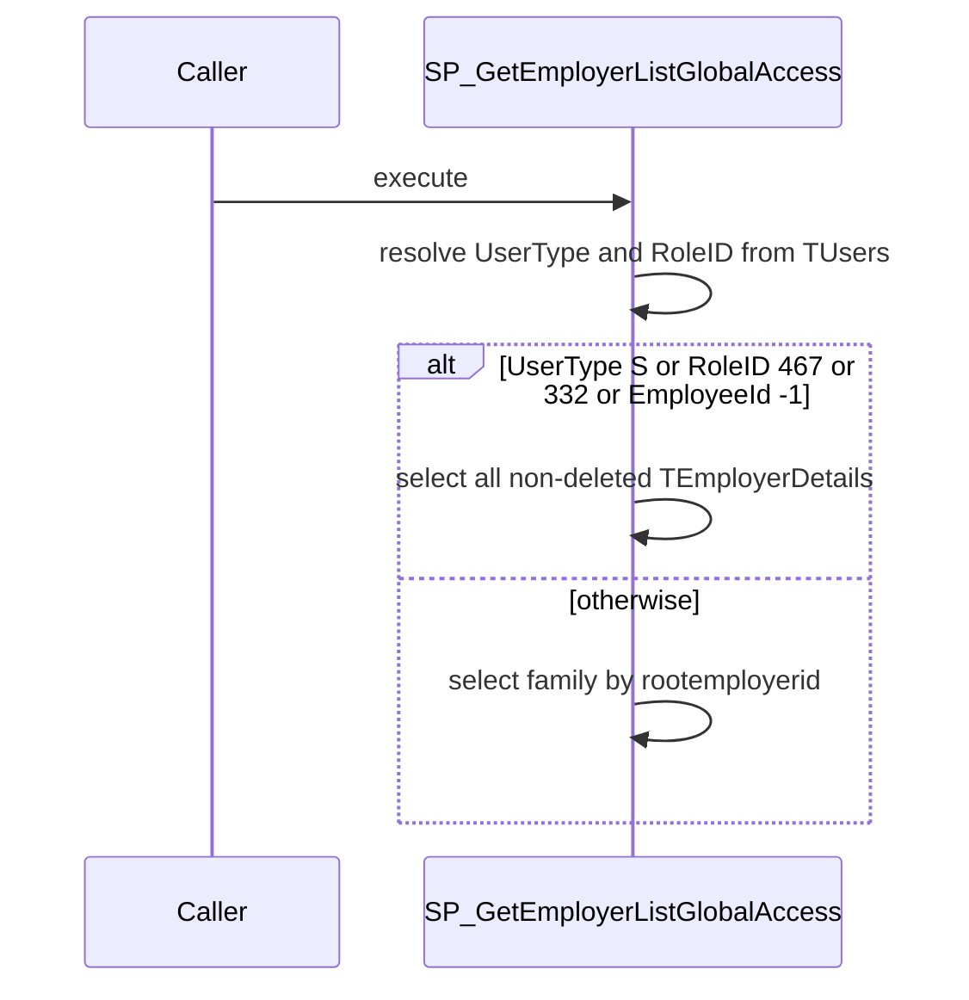
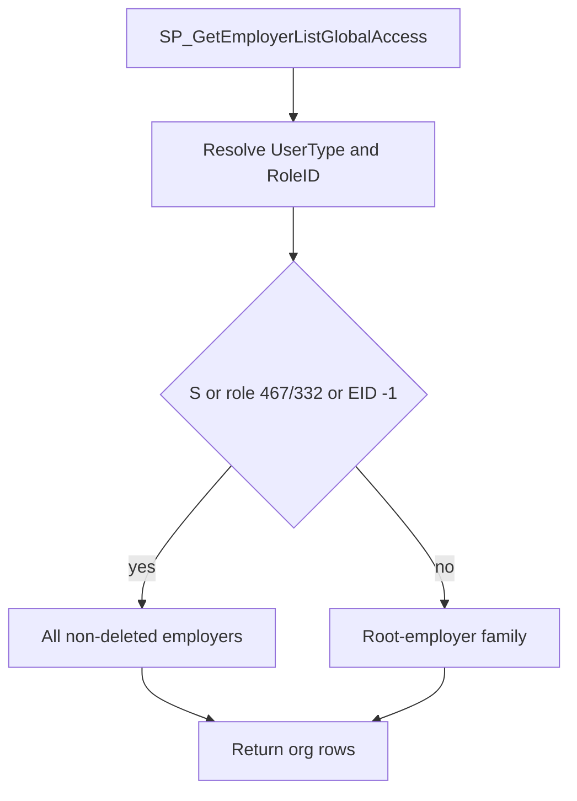

# SP_GetEmployerListGlobalAccess

## What it does

Returns organisation rows (`EmployerName`, `Employerid`, `ParentEmployerid`, `Custid`, `IsParentOrg`, optional `SelectedOrgs`) for dropdowns that need either every non-deleted employer or the caller’s `rootemployerid` family. Global visibility applies when the linked user is `UserType` `S`, role id `467` or `332`, or when `@EmployeeId` is the built-in sentinel `-1`. Otherwise it returns employers that share the employee’s root employer. Email Notification Monitor uses this procedure for the org dropdown and for server-side EmployerIds intersection.

## Parameters

| Name | Direction | What it is for |
|---|---|---|
| `@EmployeeId` | in | Caller employee id (or `-1` for the built-in super user) |
| `@GridId` | in | Optional grid id for `TRRS_GRID_CONFIG` `SelectedOrgs`; Email Notification Monitor leaves this null |

## Call sequence

## Callers

No other procedure or function calls this object. `dashBoardDAL.GetEmailNotificationMonitorAccessibleOrgs` executes it for Email Notification Monitor (`GET /dashboard/GetEmailNotificationMonitorAccessibleOrgs` and the org intersection on list/summary POSTs). Other screens may call it for the same org-list shape.

## Nested

None. This procedure calls no other procedures or functions.

## Steps

1. In `HRMS-DATABASE/HRMS/STOREPROCEDURE/SP_GetEmployerListGlobalAccess.sql`, look up `@UserType` and `@RoleID` from `TUsers` joined through `TUserEmployee` for `@EmployeeId`.
2. When `@UserType` is `S`, `@RoleID` is `467` or `332`, or `@EmployeeId` is `-1`, select every `temployerdetails` row with `IsDeleted = 0`, including a subquery for `TRRS_GRID_CONFIG` `SelectedOrgs` when `@GridId` is supplied.
3. Otherwise select the same columns for employers whose `rootemployerid` matches the employee’s employer’s root, with `IsDeleted = 0`.

## Tables

| Table | Read or write |
|---|---|
| `dbo.TUsers` | read |
| `dbo.TUserEmployee` | read |
| `dbo.temployerdetails` | read |
| `dbo.temployee` | read (family branch) |
| `dbo.TRRS_GRID_CONFIG` | read (SelectedOrgs subquery) |

## Unresolved calls

None.

## Flow

