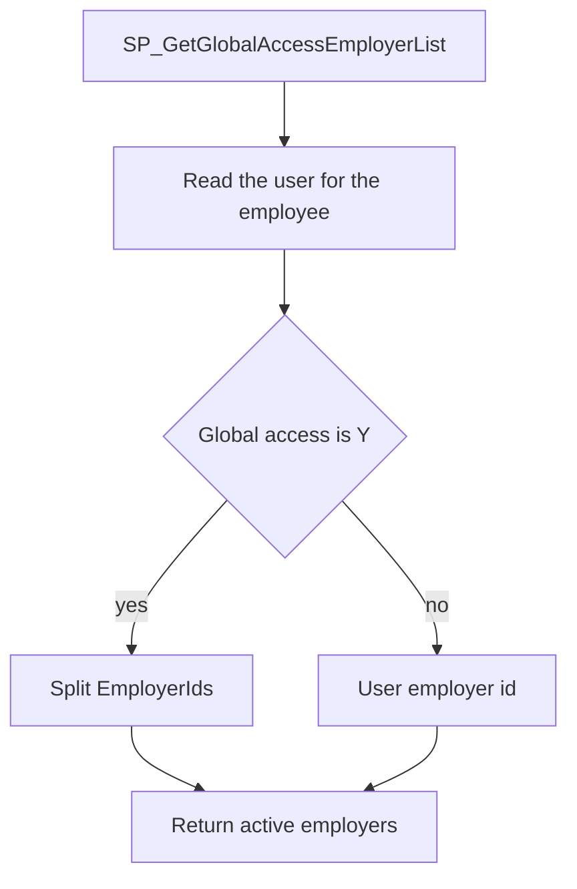

# SP_GetGlobalAccessEmployerList

## What it does

Returns the employers a user may pick as a parent when global access is on. Global-access users contribute the employer ids in TUsers.EmployerIds. Other users contribute their own TUsers.EmployerId. Deleted or inactive employers are excluded.

## Parameters

| Name | Direction | What it is for |
|---|---|---|
| `@EmployeeId` | in | Employee whose user row is read |

## Call sequence

Calls no other procedures or functions.

## Callers

Procedures and functions that call this object.

| Object | Kind | Page |
|---|---|---|
| `SP_Get_EmployeesList` | procedure | No page yet |

## Nested

Calls no other procedures or functions.

## Steps

1. Join TUsers to TUserEmployee. For IsGlobalAccess Y, split EmployerIds and join active, not-deleted TEmployerDetails.

2. Union the user's own employer when IsGlobalAccess is N or null, with the same active and not-deleted filters.

3. Return EmployerName, custid, ParentCustid, Employerid, ParentEmployerid, and RootEmployerId.

## Tables

| Table | Read or write |
|---|---|
| `TUsers` | read |
| `TUserEmployee` | read |
| `TEmployerDetails` | read |

## Flow

