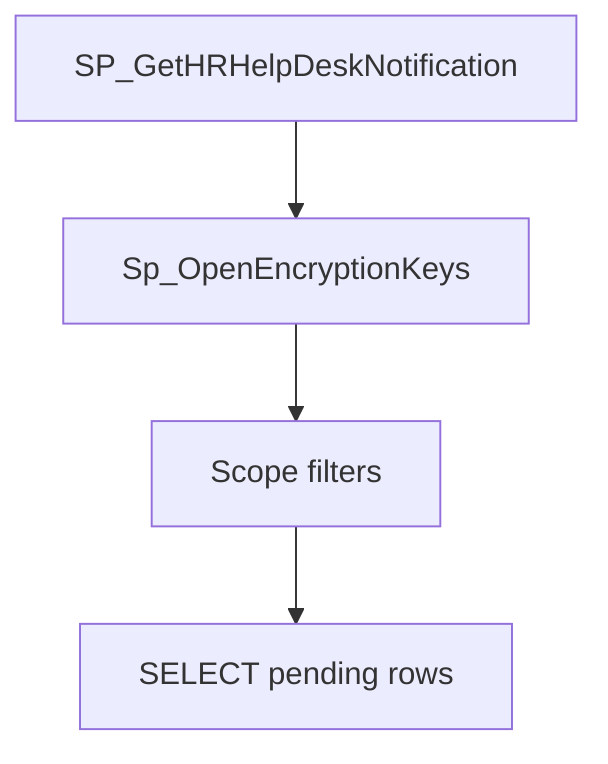

# SP_GetHRHelpDeskNotification

## What it does

Builds the pending help-desk notification set for For Me with role and BU or reportee scope. Used by ucPendingHelpdeskRequest_ForMe.

## Parameters

| Name | Direction | What it is for |
|---|---|---|
| `@EmployerId` | in | Employer |
| `@Employeeid` | in | Logged-in employee |

## Call sequence

Calls nested procedures listed under Nested when present; otherwise runs inline SQL only.

## Callers

| Object | Kind |
|---|---|
| `HelpDeskDAL.GetHelpdeskRequestsNotification` | procedure |

## Nested

- [`Sp_OpenEncryptionKeys`](/docs/database/hrms/Sp_OpenEncryptionKeys)

## Steps

1. Open encryption keys.
2. Materialize role and scope filters into temp results.
3. Return pending help-desk rows for the notification grid.

## Tables

| Table | Read or write |
|---|---|
| `THelpDesk` | read |
| `THelpDeskGroup` | read |
| `THelpDeskGroup_Category` | read |
| `THelpDeskGroup_Category_Activity` | read |

## Unresolved calls

None noted for this feature pass.

## Flow

