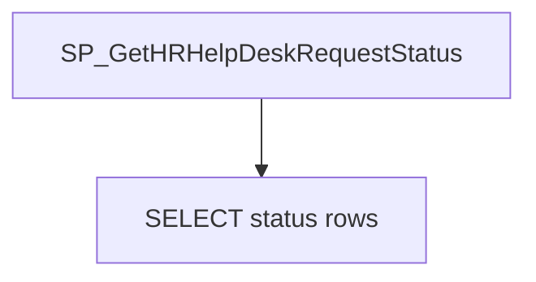

# SP_GetHRHelpDeskRequestStatus

## What it does

Returns the employee help-desk request status list for the Help Desk tab status grid.

## Parameters

| Name | Direction | What it is for |
|---|---|---|
| `@EmployeeId` | in | Employee |
| `@RequestType` | in | Filter or type string from UI |

## Call sequence

Calls nested procedures listed under Nested when present; otherwise runs inline SQL only.

## Callers

| Object | Kind |
|---|---|
| `HelpDeskDAL.GetHelpdeskRequestStatus` | procedure |

## Nested

Calls no other procedures or functions.

## Steps

1. SELECT help-desk rows for the employee. See script for the full column set.

## Tables

| Table | Read or write |
|---|---|
| `THelpDesk` | read |

## Unresolved calls

None noted for this feature pass.

## Flow

