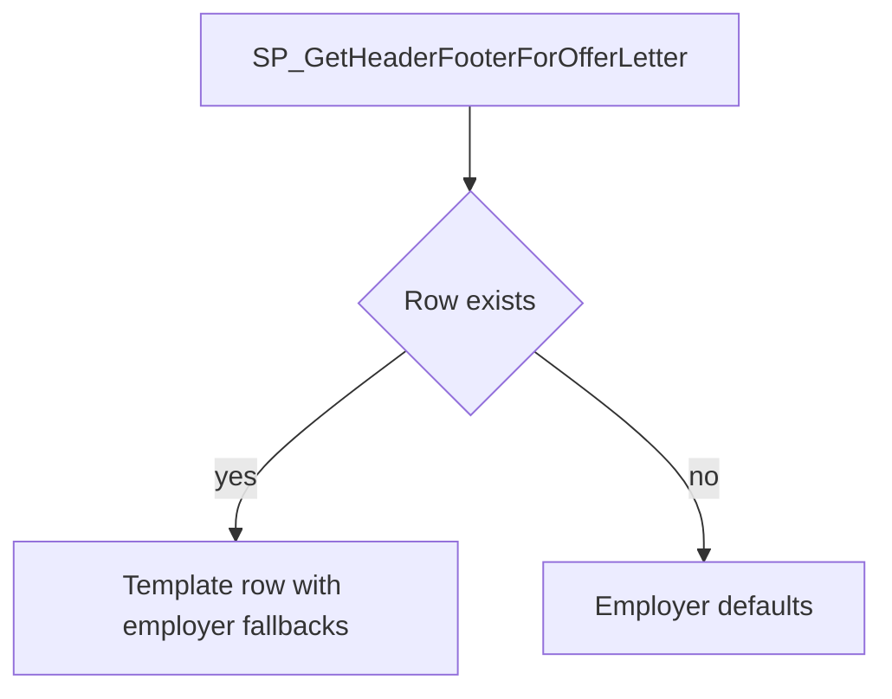

# SP_GetHeaderFooterForOfferLetter

## What it does

Returns header, footer, watermark, margins, heights, and opacity for a document. When a `TOfferLetterHeaderFooter` row exists for the document, empty image paths and zero margins fall back to `TEmployerDetails` defaults. When no row exists, it returns employer defaults with `useDefault` set to `1`.

## Parameters

| Name | Direction | What it is for |
|---|---|---|
| `@documentid` | in | Document template id |
| `@EmployerId` | in | Employer |

## Call sequence

Calls no other procedures or functions.

## Callers

No other procedure or function calls this object. `DocBuilderDAL.GetHeaderFooterDetails` executes it from Doc Builder. Classic `EmployeeDAL.GetHeaderFooterDetails` can also call it.

## Nested

Calls no other procedures or functions.

## Steps

1. Count `TOfferLetterHeaderFooter` rows for `@documentid`.
2. When a row exists, select it joined to `TEmployerDetails`, applying empty-image and zero-margin fallbacks.
3. Otherwise select employer default images and fixed default margins.

## Tables

| Table | Read or write |
|---|---|
| `dbo.TOfferLetterHeaderFooter` | read |
| `dbo.TEmployerDetails` | read |

## Unresolved calls

None.

## Flow

