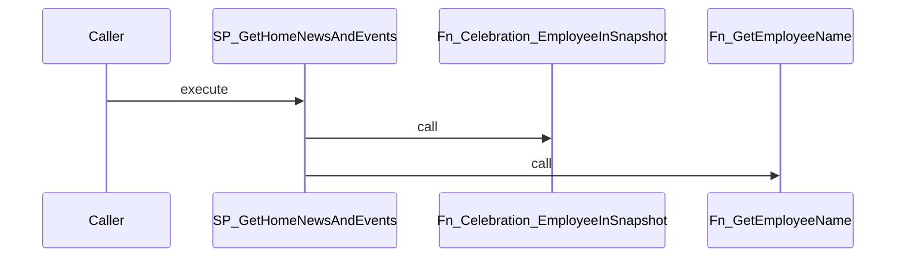
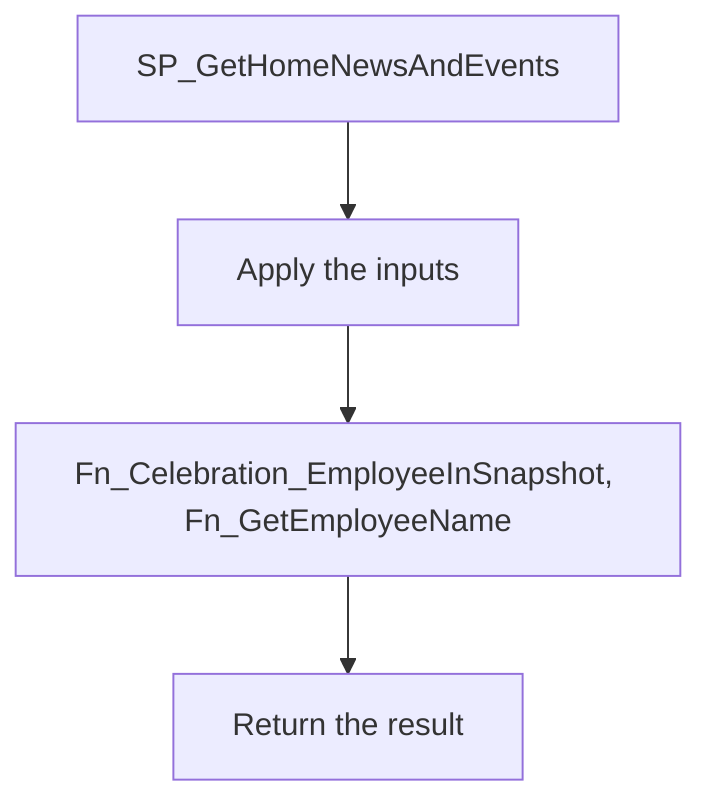

# SP_GetHomeNewsAndEvents

## What it does

Returns one page of Home news. It mixes employer news-and-events posts with celebration-hub broadcasts the employee is allowed to see, and it flags must-read items that are still unread.

## Parameters

| Name | Direction | What it is for |
|---|---|---|
| `@Employeeid` | in | Employee the Home screen is loading or acting for (`INT`) |
| `@Employerid` | in | Employer that owns the data (`INT`) |
| `@PageNumber` | in | Page number for the list. Empty uses the procedure default (`INT`) |
| `@PageSize` | in | Page size for the list. Empty uses the procedure default (`INT`) |
| `@UnreadMustReadOnly` | in | 1 when the news card asks only for unread must-read items (`BIT`) |

## Call sequence

## Callers

No other procedure or function under STOREPROCEDURE or FUNCTIONS executes this object.

## Nested

| Object | Kind | When | Page |
|---|---|---|---|
| `Fn_Celebration_EmployeeInSnapshot` | function | Called while this object runs | [Fn_Celebration_EmployeeInSnapshot](/docs/database/hrms/Fn_Celebration_EmployeeInSnapshot) |
| `Fn_GetEmployeeName` | function | Called while this object runs | [Fn_GetEmployeeName](/docs/database/hrms/Fn_GetEmployeeName) |

## Steps

In `HRMS-DATABASE/HRMS/STOREPROCEDURE/179082/SP_GetHomeNewsAndEvents.sql`:

1. Returns one page of Home news.
2. It mixes employer news-and-events posts with celebration-hub broadcasts the employee is allowed to see, and it flags must-read items that are still unread.

## Tables

| Table | Read or write |
|---|---|
| `TEmployee` | read |
| `TEmployeeInfo` | read |
| `TNEWSANDEVENTS` | read |
| `TCelebrationBroadcast` | read |
| `TCelebrationCategory` | read |
| `TCelebrationBroadcastAudienceSnapshot` | read |
| `TCelebrationBroadcastAudience` | read |
| `TCelebrationSettings` | read |
| `TCelebrationSeen` | read |
| `TDOCUMENTGROUP` | read |
| `TDOCUMENTS` | read |
| `TCelebrationAttachment` | read |

## Flow

