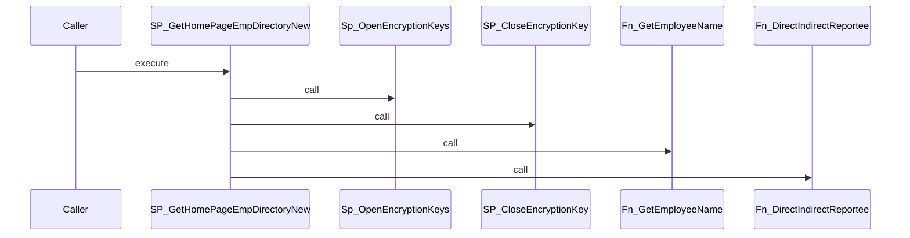
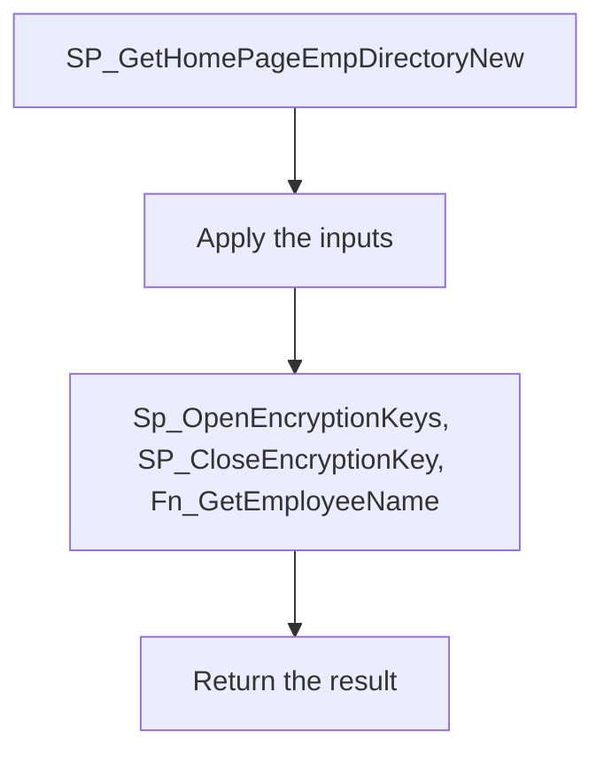

# SP_GetHomePageEmpDirectoryNew

## What it does

Searches the employee directory behind the My Team card. It can list a team, a named employee, or a paged directory, and it attaches today's attendance and leave state.

## Parameters

| Name | Direction | What it is for |
|---|---|---|
| `@Employeeid` | in | Employee the Home screen is loading or acting for (`INT`) |
| `@Employerid` | in | Employer that owns the data (`INT`) |
| `@EmployeeName` | in | Optional name filter. Empty means do not filter by name (`VARCHAR(100)`) |
| `@PageNumber` | in | Page number for the list. Empty uses the procedure default (`INT`) |
| `@PageSize` | in | Page size for the list. Empty uses the procedure default (`INT`) |

## Call sequence

## Callers

No other procedure or function under STOREPROCEDURE or FUNCTIONS executes this object.

## Nested

| Object | Kind | When | Page |
|---|---|---|---|
| `Sp_OpenEncryptionKeys` | procedure | Called while this object runs | [Sp_OpenEncryptionKeys](/docs/database/hrms/Sp_OpenEncryptionKeys) |
| `SP_CloseEncryptionKey` | procedure | Called while this object runs | [SP_CloseEncryptionKey](/docs/database/hrms/SP_CloseEncryptionKey) |
| `Fn_GetEmployeeName` | function | Called while this object runs | [Fn_GetEmployeeName](/docs/database/hrms/Fn_GetEmployeeName) |
| `Fn_DirectIndirectReportee` | function | Called while this object runs | [Fn_DirectIndirectReportee](/docs/database/hrms/Fn_DirectIndirectReportee) |

## Steps

In `HRMS-DATABASE/HRMS/STOREPROCEDURE/SP_GetHomePageEmpDirectoryNew.sql`:

1. Searches the employee directory behind the My Team card.
2. It can list a team, a named employee, or a paged directory, and it attaches today's attendance and leave state.

## Tables

| Table | Read or write |
|---|---|
| `TEmployeeInfo` | read |
| `TEmployee` | read |
| `TEmployerDetails` | read |
| `TLocation` | read |
| `TAttendanceTransaction` | read |
| `TLeaveRequestDays` | read |
| `TLeaveTypeMaster` | read |
| `TEmployeeContactDetails` | read |
| `TOrgHierarchyDetails` | read |
| `TTitle` | read |

## Flow

