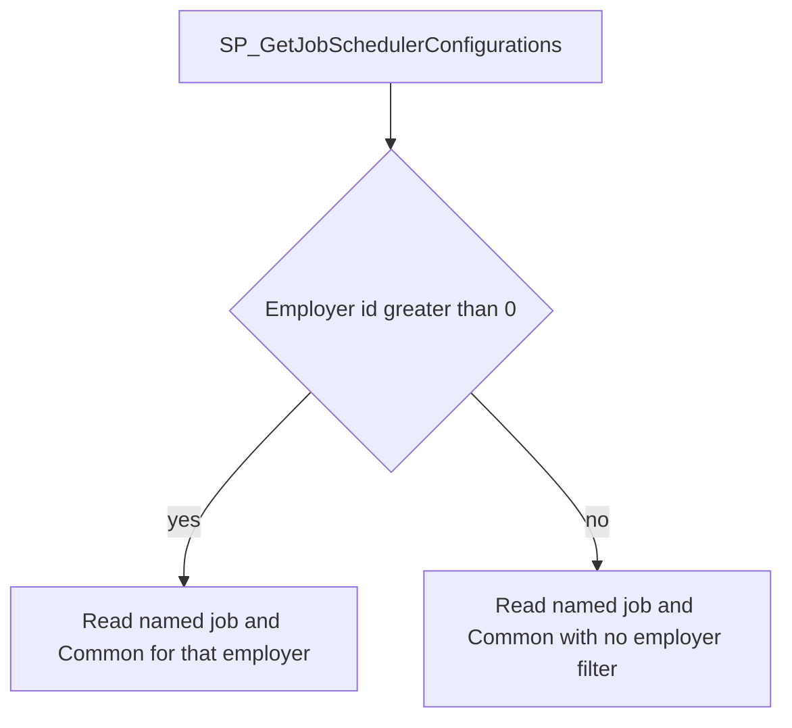

# SP_GetJobSchedulerConfigurations

## What it does

Returns `ConfigValue` and `ConfigKey` from `TJobSchedulerConfiguration`. When an employer id greater than 0 is passed, both the named job and the `Common` rows are limited to that employer. Otherwise the filter is by scheduler name and key only. The schedule-saved email calls it without an employer id.

## Parameters

| Name | Direction | What it is for |
|---|---|---|
| `@SchedulerName` | in | Job name. Null matches every name. Default null |
| `@ConfigKey` | in | Configuration key. Null matches every key. Default null |
| `@EmployerId` | in | Organisation. Default null. Only values greater than 0 take the employer branch |

## Call sequence

Calls no other procedures or functions.

## Callers

Procedures and functions that call this object.

No other procedure or function calls this object.

## Nested

Calls no other procedures or functions.

## Steps

1. In `HRMS-DATABASE/HRMS/STOREPROCEDURE/SP_GetJobSchedulerConfigurations.sql`, when `@EmployerId` is greater than 0, select `ConfigValue` and `ConfigKey` for the scheduler name and key, limited to that employer, and union the `Common` rows for the same key and employer.

2. Otherwise select the same two columns for the scheduler name and key with no employer predicate, and union `Common` rows for that key with no employer predicate.

## Tables

| Table | Read or write |
|---|---|
| `TJobSchedulerConfiguration` | read |

## Flow

