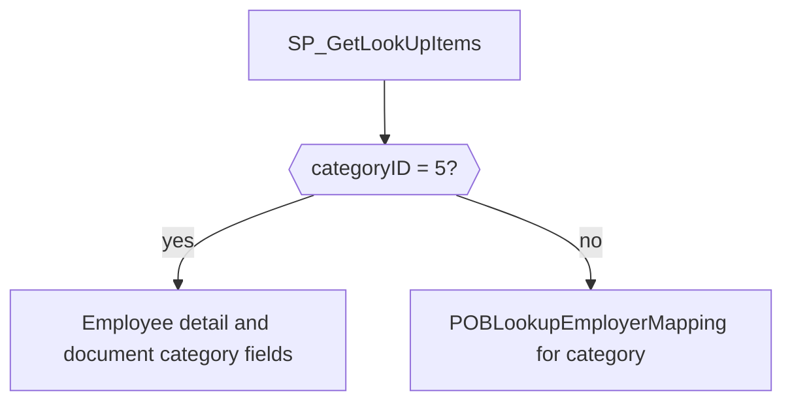

# SP_GetLookUpItems

## What it does

Returns the field picker rows for a template category and country. Category 5 mixes employee-detail fields with document-category lookup items. Other categories return employer-mapped lookup items for the matching `POBTemplateCategory`.

## Parameters

| Name | Direction | What it is for |
|---|---|---|
| `@EmployerID` | in | Employer whose mappings and fields are read |
| `@CountryID` | in | Country used for country-scoped employee-detail fields |
| `@categoryID` | in | Template category id |

## Call sequence

Calls no other procedures or functions.

## Callers

No other procedure or function calls this object.

## Nested

Calls no other procedures or functions.

## Steps

1. When `@categoryID` is 5, select active unhidden fields from `temployeedetail_fields` joined to section and section-category, plus POB document-category lookup mappings, and order by section and item.
2. Otherwise resolve `@TCategoryID` from `POBTemplateCategory` and `temployeedetail_category`, then select active unhidden `POBLookupEmployerMapping` rows for that template category.

## Tables

| Table | Read or write |
|---|---|
| `temployeedetail_fields` | read |
| `temployeedetail_section` | read |
| `temployeedetail_section_Category` | read |
| `POBLookupEmployerMapping` | read |
| `POBLookupItems` | read |
| `POBLookupMaster` | read |
| `TAttachmentCategory` | read |
| `POBTemplateCategory` | read |
| `temployeedetail_category` | read |
| `TEmployeeDetail_Section` | read |

## Flow

