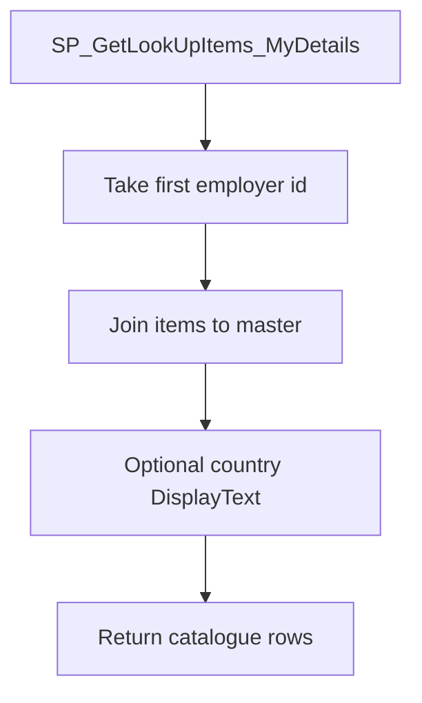

# SP_GetLookUpItems_MyDetails

## What it does

Returns the My Details lookup-item catalogue used when configuring fields before an employer-specific mapping is loaded. It takes the first employer id from a comma-separated list, then lists distinct items from `POBLookupItems` joined to `POBLookupMaster`, optionally overriding `DisplayText` from `POBCandidateCountryFields` for that employer. Result rows expose default `IsMandatory`, `IsDefault`, `IsHide = 0`, and `ColumnType = LookupData`.

## Parameters

| Name | Direction | What it is for |
|---|---|---|
| `@EmployerIds` | in | Comma-separated employer ids; only the first value is used for country-field overrides |

## Call sequence

Calls no other procedures or functions.

## Callers

No other procedure or function calls this object. Application caller: Core API `preOnBoardingDAL.GetLookupItemsForMyDetails` for Field Config page init.

## Nested

Calls no other procedures or functions.

## Steps

1. Script is `HRMS-DATABASE/HRMS/STOREPROCEDURE/SP_GetLookUpItems_MyDetails.sql`.
2. Set `@EmployerId` to the first value from `STRING_SPLIT(@EmployerIds, ',')`.
3. Select distinct lookup master/item columns from `POBLookupItems` and `POBLookupMaster`.
4. Left join `POBCandidateCountryFields` for the same lookup item and `@EmployerId` to prefer country-specific `DisplayText`.
5. Return fixed `ColumnType` `LookupData` and `IsHide` `0`.

## Tables

| Table | Read or write |
|---|---|
| `dbo.POBLookupItems` | read |
| `dbo.POBLookupMaster` | read |
| `dbo.POBCandidateCountryFields` | read |

## Flow

