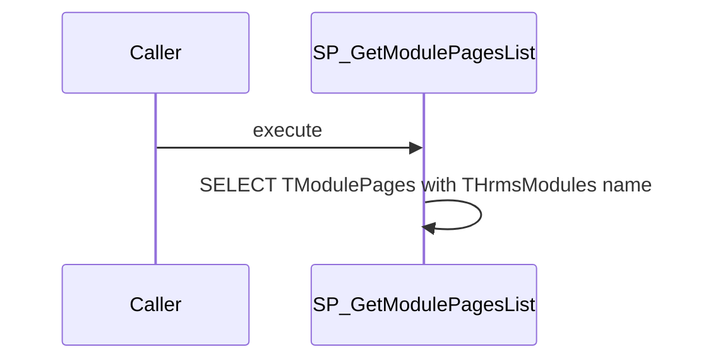
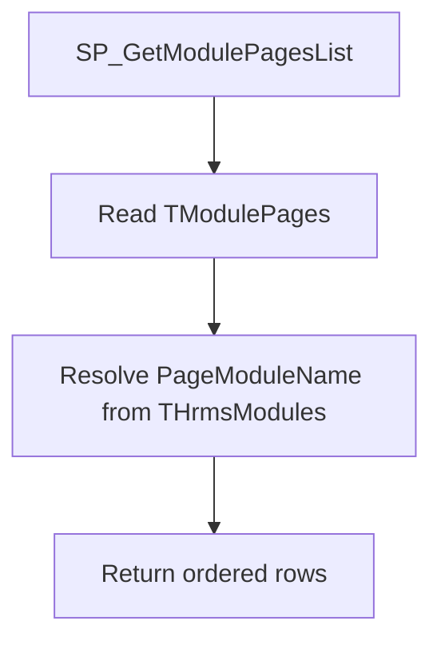

# SP_GetModulePagesList

## What it does

Returns every row from `TModulePages` with the parent module name resolved from `THrmsModules`. Used by the Access Rights Management API’s module-pages catalog endpoint.

## Parameters

None.

## Call sequence

Calls no other procedures or functions.

## Callers

Procedures and functions that call this object.

No other procedure or function calls this object. Application caller: Core Node `AccessRightsManagementDAL.getModulePagesList` via `GET /api/accessRightsManagement/modulePages` (BLL currently mis-cases the DAL method name).

## Nested

Calls no other procedures or functions.

## Steps

1. Select `ModulePageId`, `ModulePageName`, scalar `ModuleName` from `THrmsModules` where `ModuleId = PageModuleID` as `PageModuleName`, `MappedAppPage`, and `Pagemoduleid` from `TModulePages`.

2. Order by `ModulePageId ASC`.

## Tables

| Table | Read or write |
|---|---|
| `TModulePages` | read |
| `THrmsModules` | read |

## Unresolved calls

None.

## Flow

