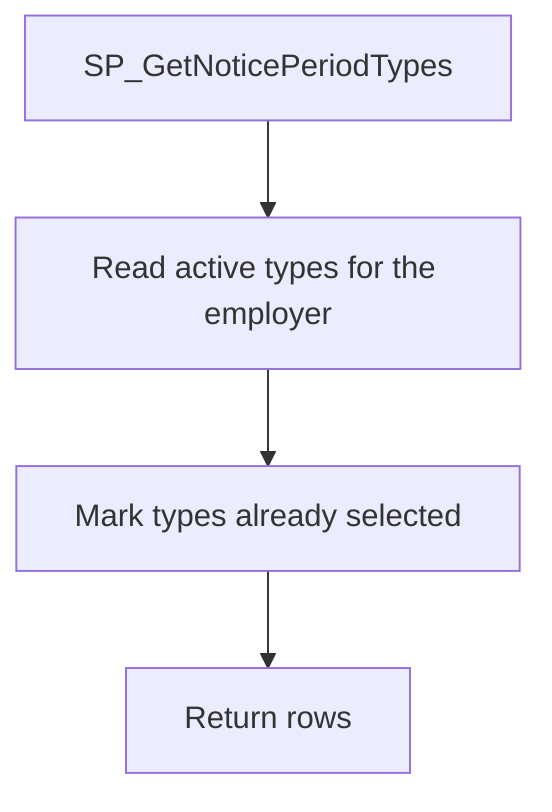

# SP_GetNoticePeriodTypes

## What it does

Returns active notice-period bases for one employer, and marks each row active in the result when that code is present in the employer's current NoticePeriodBasedOn list.

## Parameters

| Name | Direction | What it is for |
|---|---|---|
| `@EmployerId` | in | Employer whose notice-period types are listed |

## Call sequence

Calls no other procedures or functions.

## Callers

Procedures and functions that call this object.

No other procedure or function calls this object.

## Nested

Calls no other procedures or functions.

## Steps

1. Select active tNoticePeriodTypes for @EmployerId, joined to tEmployerDetails on EmployerId.

2. Set IsActiveType to 1 when NoticePeriodBasedOn appears in STRING_SPLIT of the employer's NoticePeriodBasedOn.

## Tables

| Table | Read or write |
|---|---|
| `tNoticePeriodTypes` | read |
| `tEmployerDetails` | read |

## Flow

