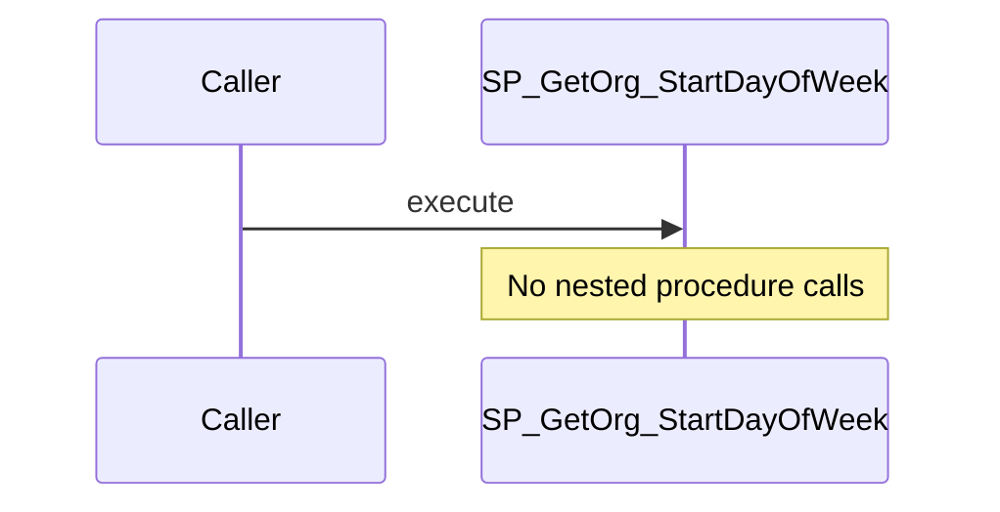
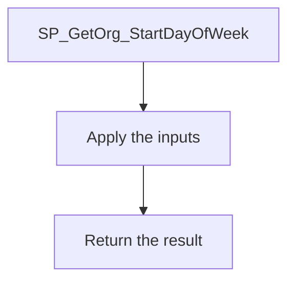

# SP_GetOrg_StartDayOfWeek

## What it does

Returns `StartDayOfWeek` from `TEmployerDetails` for an employer. TimePort uses this (via synonym) so the TimeSheet week grid aligns with the org calendar.

## Parameters

| Name | Direction | What it is for |
|---|---|---|
| `@EmployerID` | in | Employer id |

## Call sequence

## Callers

Nested from `Sp_TS_GetEmpTimeSheetMonthWise` and `Sp_TS_GetEmpTimeSeetAttendanceDetails`. Also Home attendance cards.

## Nested

| Object | Kind | When | Page |
|---|---|---|---|
| _(none)_ | — | — | — |

## Steps

In `HRMS-DATABASE/HRMS/STOREPROCEDURE/SP_GetOrg_StartDayOfWeek.sql`:

1. Select StartDayOfWeek from `TEmployerDetails` where EmployerID matches.

## Tables

| Table | Read or write |
|---|---|
| `TEmployerDetails` | read |

## Unresolved calls

None identified beyond the nested objects listed above.

## Flow

