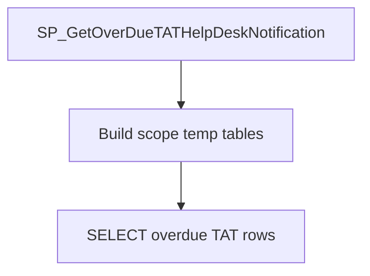

# SP_GetOverDueTATHelpDeskNotification

## What it does

Returns help-desk requests past activity TAT for the logged-in employee location, BU, reportee, and functional-authority scope for the Over Due TAT panel.

## Parameters

| Name | Direction | What it is for |
|---|---|---|
| `@EmployerId` | in | Employer |
| `@EmployeeId` | in | Viewer |

## Call sequence

Calls nested procedures listed under Nested when present; otherwise runs inline SQL only.

## Callers

| Object | Kind |
|---|---|
| `HelpDeskDAL.GetOverDueHelpdeskRequestsNotification` | procedure |
| `EmployeeSelfService.aspx.cs` | application |

## Nested

- [`Sp_OpenEncryptionKeys`](/docs/database/hrms/Sp_OpenEncryptionKeys)

## Steps

1. Materialize location, reportee, and functional-authority employee sets.
2. SELECT overdue help-desk rows with TAT and owner columns.

## Tables

| Table | Read or write |
|---|---|
| `THelpDesk` | read |
| `TORGChart` | read |
| `THelpDeskGroup_Category_Activity` | read |

## Unresolved calls

None noted for this feature pass.

## Flow

