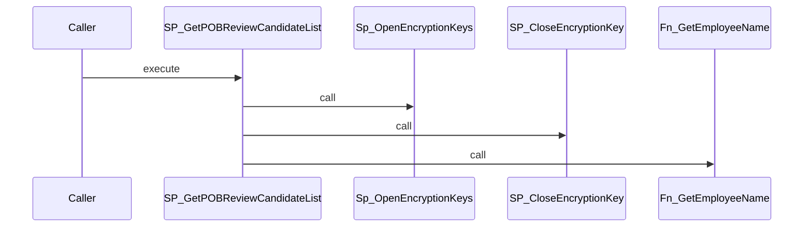
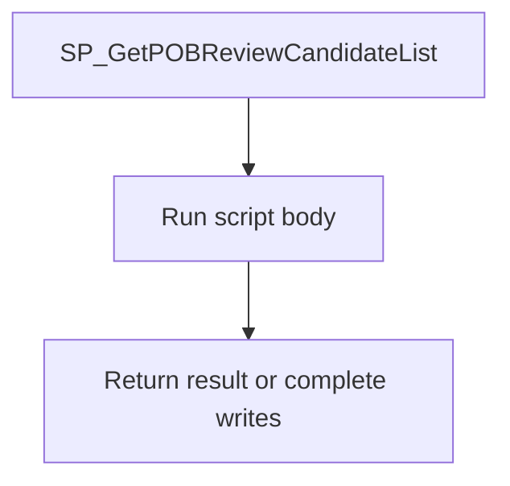

# SP_GetPOBReviewCandidateList

## What it does

Lists candidates ready for HR review on the Review tab.

## Parameters

| Name | Direction | What it is for |
|---|---|---|
| `@Employerid` | in | INT |

## Call sequence

## Callers

Application callers include Core API `preOnBoardingDAL` methods used by **Employee Management → Pre-Onboarding Candidate** (`PreOnboardCandidate.aspx`). Search HRMS `STOREPROCEDURE/` and `FUNCTIONS/` for additional `EXEC`/`dbo.` callers when extending this page.

## Nested

| Object | Kind | When | Page |
|---|---|---|---|
| `Sp_OpenEncryptionKeys` | procedure | always when reached | [Sp_OpenEncryptionKeys](/docs/database/hrms/Sp_OpenEncryptionKeys) |
| `SP_CloseEncryptionKey` | procedure | always when reached | [SP_CloseEncryptionKey](/docs/database/hrms/SP_CloseEncryptionKey) |
| `Fn_GetEmployeeName` | function | always when reached | [Fn_GetEmployeeName](/docs/database/hrms/Fn_GetEmployeeName) |

## Steps

From `HRMS-DATABASE/HRMS/STOREPROCEDURE/SP_GetPOBReviewCandidateList.sql`:

1. Executes `Sp_OpenEncryptionKeys`.
2. Executes `SP_CloseEncryptionKey`.

## Tables

| Table | Read or write |
|---|---|
| `dbo.TEMAILCOMMUNICATION` | read |
| `dbo.POBCandidate` | read |
| `dbo.POBCandidateTemplate` | read |
| `dbo.POBCandidateLogin` | read |
| `dbo.TRRSCandidate` | read |

## Flow

