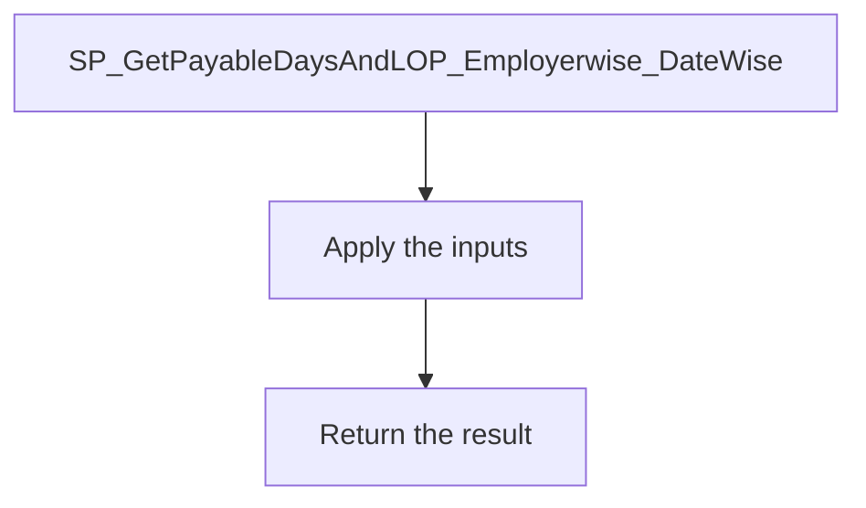

# SP_GetPayableDaysAndLOP_Employerwise_DateWise

## What it does

Returns payable days and LOP for employees in a date range; used by leave credit schedulers.

## Parameters

| Name | Direction | What it is for |
|---|---|---|
| `@Employerid` | in | `INT` |
| `@StartDate` | in | `DATE` |
| `@EndDate` | in | `DATE` |
| `@LeaveCodesFilter` | in | `VARCHAR(MAX)` |

## Call sequence

Calls no other procedures or functions.

## Callers

| Object | Kind | Page |
|---|---|---|
| `SP_CatchUpLeaveCredit_ForEmployee` | procedure | No page yet |
| `SP_MonthlyLeaveCredit` | procedure | [SP_MonthlyLeaveCredit](/docs/database/hrms/SP_MonthlyLeaveCredit) |
| `SP_MonthlyLeaveCreditPreview` | procedure | No page yet |
| `SP_QHYLeaveCredit` | procedure | [SP_QHYLeaveCredit](/docs/database/hrms/SP_QHYLeaveCredit) |

## Nested

Calls no other procedures or functions.

## Steps

In `HRMS-DATABASE/HRMS/STOREPROCEDURE/SP_GetPayableDaysAndLOP_Employerwise_DateWise.sql`:
1. Accept the declared parameters and run the procedure or function body.
3. Read or write the tables listed under Tables.
4. Return result sets, scalar values, or status as defined in the script.

## Tables

| Table | Read or write |
|---|---|
| `tDailyRegisterNew` | read or write |
| `TEmployee` | read or write |
| `TEmployeeInfo` | read or write |
| `tHolidayMaster` | read or write |
| `TLeaveRequest` | read or write |
| `TLeaveRequestDays` | read or write |
| `TLeaveTypeMaster` | read or write |
| `TOptionalHolidayRequest` | read or write |

## Flow

