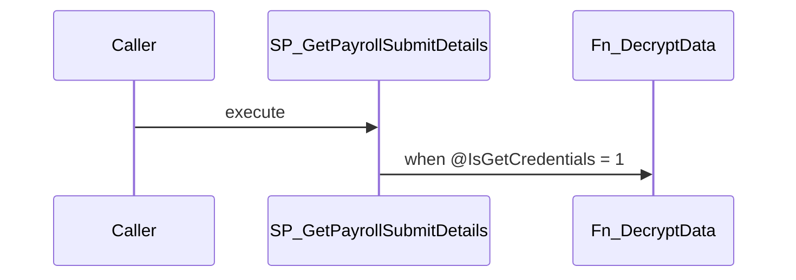
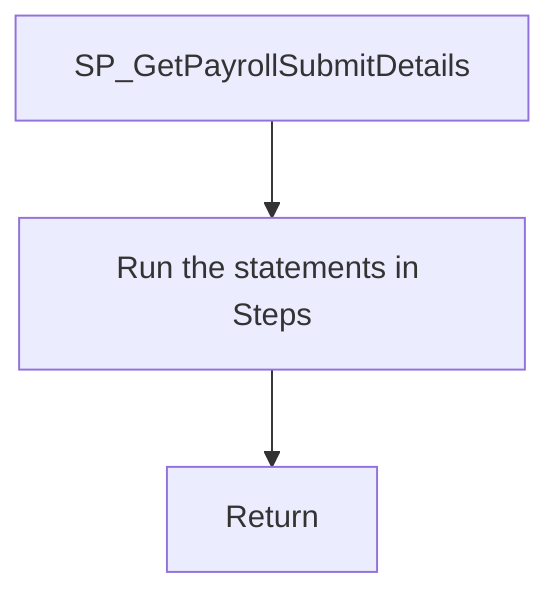

# SP_GetPayrollSubmitDetails

## What it does

Returns external payroll configuration for a customer from TExternal_Payroll_Configuration. When credentials are requested, decrypts username and password.

## Parameters

| Name | Direction | What it is for |
|---|---|---|
| `@CustomerId` | in | Customer id |
| `@IsGetCredentials` | in | 0 = config without secrets; 1 = include decrypted username/password and batch settings |

## Call sequence

## Callers

No other procedure or function calls this object.

## Nested

| Object | Kind | When | Page |
|---|---|---|---|
| `Fn_DecryptData` | function | when @IsGetCredentials = 1 | [Fn_DecryptData](/docs/database/hrms/Fn_DecryptData) |

## Steps

1. Enter TRY block.
2. If @IsGetCredentials = 0, select api key, base URL, enabled flag, customer/provider names, and sync-job settings for the customer.
3. Else select the same fields plus MaxConcurrency, PageSize, TokenLifespanSeconds, BatchSize, and decrypted Username/Password via Fn_DecryptData.
4. On CATCH, RAISERROR with the captured error values.

## Tables

| Table | Read or write |
|---|---|
| `dbo.TExternal_Payroll_Configuration` | read |

## Flow

