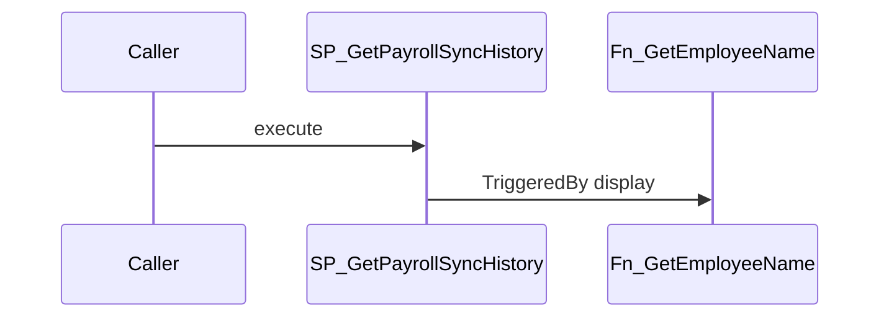
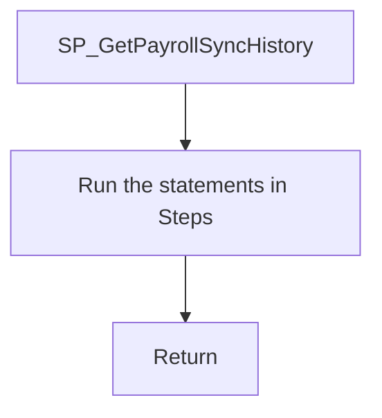

# SP_GetPayrollSyncHistory

## What it does

Returns payroll sync history rows for an employer within the configured day window from tcustomersettings.

## Parameters

| Name | Direction | What it is for |
|---|---|---|
| `@EmployerId` | in | Employer scope |

## Call sequence

## Callers

No other procedure or function calls this object.

## Nested

| Object | Kind | When | Page |
|---|---|---|---|
| `Fn_GetEmployeeName` | function | TriggeredBy display | [Fn_GetEmployeeName](/docs/database/hrms/Fn_GetEmployeeName) |

## Steps

1. Read ShowPayrollSyncHistoryForDays from tcustomersettings (default 3650 when null).
2. Select sync history fields and TriggeredBy = Fn_GetEmployeeName + employment number.
3. Filter by employer and CreatedDate within the day window.
4. Order by SyncStartDateTime descending.

## Tables

| Table | Read or write |
|---|---|
| `dbo.TPayrollSyncHistory` | read |
| `dbo.tcustomersettings` | read |
| `dbo.tEmployeeInfo` | read |

## Flow

