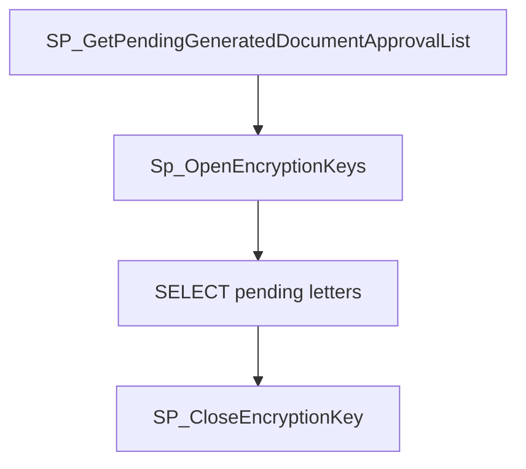

# SP_GetPendingGeneratedDocumentApprovalList

## What it does

Lists ESS-generated documents awaiting employee acceptance or acknowledgement for the Notification For Me document panel.

## Parameters

| Name | Direction | What it is for |
|---|---|---|
| `@EmployeeId` | in | Employee |

## Call sequence

Calls nested procedures listed under Nested when present; otherwise runs inline SQL only.

## Callers

| Object | Kind |
|---|---|
| `EmployeeDal.GetPendingGeneratedDocumentForEmployeeApprovalList` | procedure |
| `EmployeeSelfService.aspx.cs` | application |

## Nested

- [`Sp_OpenEncryptionKeys`](/docs/database/hrms/Sp_OpenEncryptionKeys)
- [`SP_CloseEncryptionKey`](/docs/database/hrms/SP_CloseEncryptionKey)

## Steps

1. Open encryption keys.
2. SELECT TEmployeeDocumentGeneratedDetails joined to active TDocumentTemplates where EmployeeAcceptance or EnableAcknowledgement requires action.
3. Close encryption keys.

## Tables

| Table | Read or write |
|---|---|
| `TEmployeeDocumentGeneratedDetails` | read |
| `TDocumentTemplates` | read |
| `TAttachmentCategory` | read |
| `tRequestWorkFlows` | read |

## Unresolved calls

None noted for this feature pass.

## Flow

