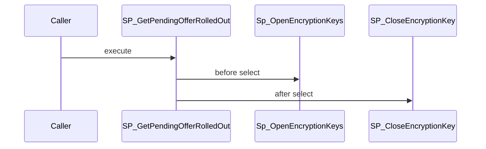
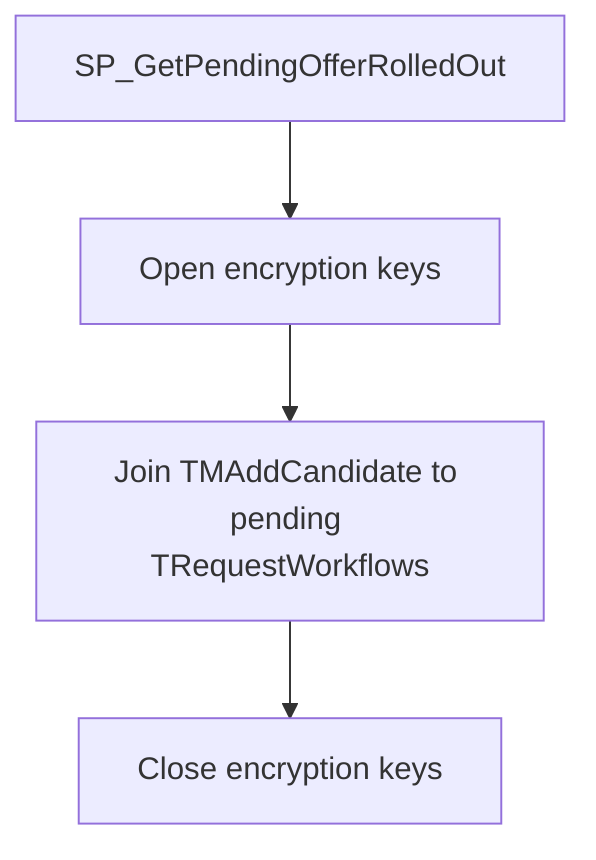

# SP_GetPendingOfferRolledOut

## What it does

Returns Offer Rolled Out candidates that have a pending DirectCandidate workflow row for the given employee (approver). Joins `TMAddCandidate` to `TRequestWorkflows` where `RequestType = 'DirectCandidate'`, `ManagerId = @EmployeeId`, and `ApproveStatus = 'P'`.

## Parameters

| Name | Direction | What it is for |
|---|---|---|
| `@EmployeeId` | in | Approver whose pending rows are returned |

## Call sequence

## Callers

No other procedure or function calls this object.

## Nested

| Object | Kind | When | Page |
|---|---|---|---|
| `Sp_OpenEncryptionKeys` | procedure | before the select | [Sp_OpenEncryptionKeys](/docs/database/hrms/Sp_OpenEncryptionKeys) |
| `SP_CloseEncryptionKey` | procedure | after the select | [SP_CloseEncryptionKey](/docs/database/hrms/SP_CloseEncryptionKey) |
| `DecryptSql` | function | AnnualCTC column | [DecryptSql](/docs/database/hrms/DecryptSql) |

## Steps

1. Open encryption keys.
2. Select candidate columns from `TMAddCandidate` joined to pending `TRequestWorkflows` for `DirectCandidate` and `@EmployeeId`.
3. Close encryption keys.

## Tables

| Table | Read or write |
|---|---|
| `TMAddCandidate` | read |
| `TRequestWorkflows` | read |
| `TTitle` | read |
| `TLocation` | read |

## Flow

