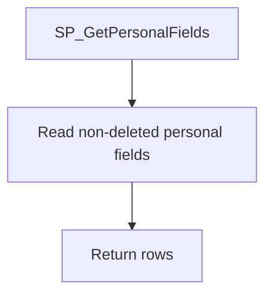

# SP_GetPersonalFields

## What it does

Returns personal-field names for the purge list. The four parameters are accepted and not used. Every row with Isdeleted 0 is returned.

## Parameters

| Name | Direction | What it is for |
|---|---|---|
| `@RequestType` | in | Accepted and not referenced |
| `@FormName` | in | Accepted and not referenced |
| `@FieldCategory` | in | Accepted and not referenced. Default null |
| `@Employerid` | in | Accepted and not referenced |

## Call sequence

Calls no other procedures or functions.

## Callers

Procedures and functions that call this object.

No other procedure or function calls this object.

## Nested

Calls no other procedures or functions.

## Steps

1. Select Fieldid, FieldName, DisplayName, and DBTableName from TPersonalfields where Isdeleted is 0.

## Tables

| Table | Read or write |
|---|---|
| `TPersonalfields` | read |

## Flow

