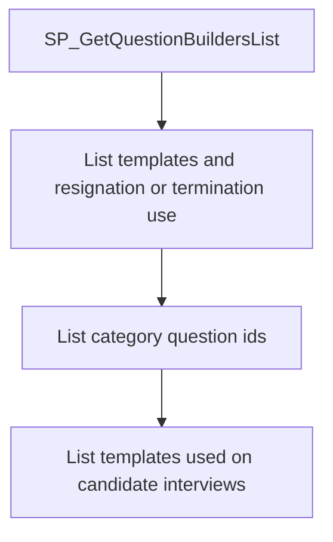

# SP_GetQuestionBuildersList

## What it does

Returns three result sets for one employer's question templates. The first lists exit-interview templates and whether resignation or termination rows use them. The second lists active template categories and the question ids in each category. The third lists templates that are already used on a candidate interview. Add Questionnaire reads the second set and blocks delete when the question id appears in `CategoryQuestion`.

## Parameters

| Name | Direction | What it is for |
|---|---|---|
| `@EmployerId` | in | Organisation whose templates and categories are listed |

## Call sequence

Calls no other procedures or functions. The comment at the top of the script shows an example `EXEC` and is not a call.

## Callers

No other procedure or function calls this object. `recruitmentDAL.GetQuestionBuilderList` executes it for Add Questionnaire.

## Nested

Calls no other procedures or functions.

## Steps

1. Select templates from `TExitInterviewTemplate` where `employerid` matches and `Isdeleted` is 0. Left-join `TTemplateModule` and `THrmsModules`. Set `IsTemplateUsed` when `TResignationDetails` or `TTerminationDetail` stores that template id. Include interview scoring columns. Order by `Transid` descending.
2. Select active `TTemplateModuleCategory` rows for the employer. For each category, build `CategoryQuestion` from distinct `TAssignedQuestions.QuestionId` values whose `TemModCategoryId` matches, and build `QuestionControlType` by joining those rows to `TQuestionnaireMaster`.
3. Select distinct templates that `TRRSCandidateInterview` references, with the same module joins, and set `IsTemplateUsed` from a count of `TResignationDetails`. Order by `Transid`.

## Tables

| Table | Read or write |
|---|---|
| `TExitInterviewTemplate` | read |
| `TTemplateModule` | read |
| `THrmsModules` | read |
| `TResignationDetails` | read |
| `TTerminationDetail` | read |
| `TTemplateModuleCategory` | read |
| `TAssignedQuestions` | read |
| `TQuestionnaireMaster` | read |
| `TRRSCandidateInterview` | read |

## Flow

