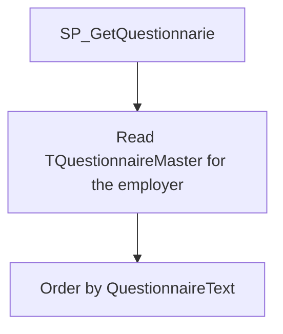

# SP_GetQuestionnarie

## What it does

Returns every questionnaire row for one employer. Add Questionnaire loads this list into the grid and reloads it after a save or delete. The result includes comment-box and scoring columns and is ordered by question text.

## Parameters

| Name | Direction | What it is for |
|---|---|---|
| `@Employerid` | in | Organisation whose questions are listed |

## Call sequence

Calls no other procedures or functions.

## Callers

No other procedure or function calls this object. `recruitmentDAL.GetQuestionnaire` executes it for Add Questionnaire.

## Nested

Calls no other procedures or functions.

## Steps

1. Select question id, text, control type, active and mandatory flags, choice count and text, comment-box flags, and scoring columns from `TQuestionnaireMaster`.
2. Keep rows where `Employerid` equals `@Employerid`.
3. Order by `QuestionnaireText`.

## Tables

| Table | Read or write |
|---|---|
| `TQuestionnaireMaster` | read |

## Flow

