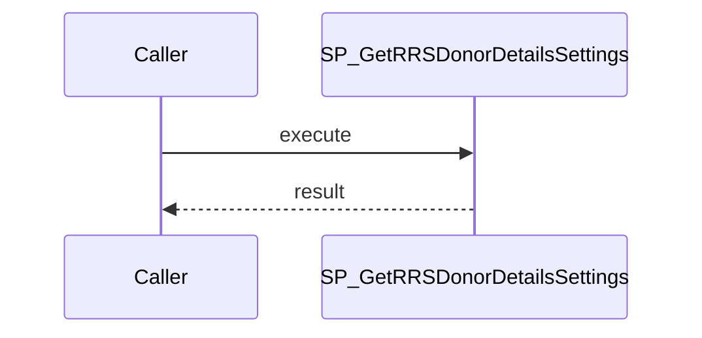
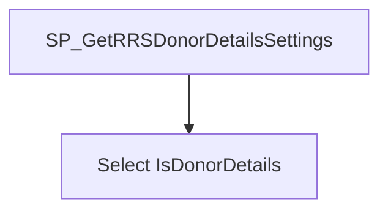

# SP_GetRRSDonorDetailsSettings

## What it does

Returns `IsDonorDetails` from `TCustomerSettings` for an employer. Expense Report uses it to show or hide the budget-source filter section.

## Parameters

| Name | Direction | What it is for |
|---|---|---|
| `@EmployerId` | in | Employer scope |

## Call sequence

## Callers

| Caller | Page |
|---|---|
| `EmployeeDAL.getRRSDonorDetailsSettings` | [Report](/docs/guides/expense-and-reimbursement/report) |

## Nested

Calls no other procedures or functions.

## Steps

1. `SELECT IsDonorDetails FROM TCustomerSettings WHERE EmployerId=@EmployerId`.

## Tables

| Table | Read or write |
|---|---|
| `TCustomerSettings` | read |

## Unresolved calls

None.

## Flow

