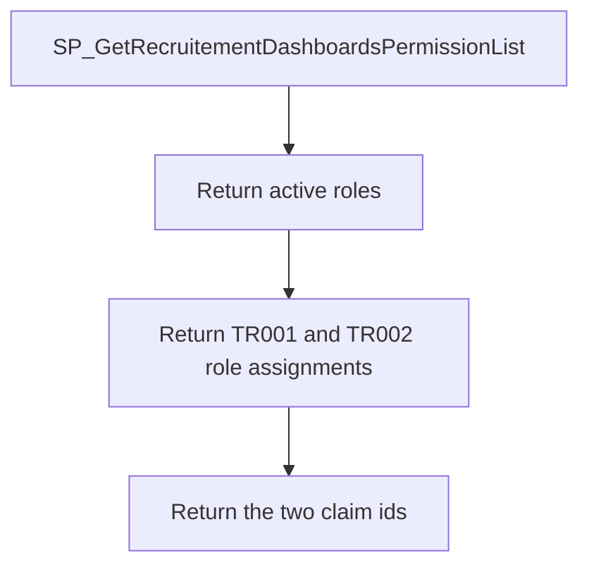

# SP_GetRecruitementDashboardsPermissionList

## What it does

Returns three result sets for the dashboard-permission role panel. Active roles for the employer, role assignments for claims `TR001` and `TR002`, and the claim ids for those two short texts.

## Parameters

| Name | Direction | What it is for |
|---|---|---|
| `@EmployerId` | in | Organisation |

## Call sequence

Calls no other procedures or functions.

## Callers

No other procedure or function calls this object.

`recruitmentDAL.GetRecruitementDashboardsPermissionList` calls it from Recruitment Management.

## Nested

Calls no other procedures or functions.

## Steps

1. Select active `TRoles` whose employer is `@EmployerId` or 0 (`SP_GetRecruitementDashboardsPermissionList.sql`).
2. Select `TRecruitmentClaim_ASSIGNMENT` rows that have a role, joined to `TRecruitmentClaim`, `TEmployerDetails`, and active `TRoles`, limited to claim short texts `TR001` and `TR002`.
3. Select `RecruitmentClaimID` and `RecruitmentClaimText_Short` for those two short texts.

## Tables

| Table | Read or write |
|---|---|
| `TRoles` | read |
| `TRecruitmentClaim_ASSIGNMENT` | read |
| `TRecruitmentClaim` | read |
| `TEmployerDetails` | read |

## Flow

